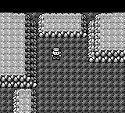
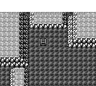

# FLASH shared interrupt and palette scanout candidate

This is local, unfinished integration work for #324, based on master
`5b3cd42342aa9aabc2546fb5f925c3b7d2a9a414` and public #324 head
`9fb5633195bd4955e4e1140e66f96ec56893e317`. It is not a merge approval.

The restoration now services video requests, shadow OAM/DMA, random state,
fade/audio instructions, play time, input sampling and RETI on the existing
display timeline. Audio uses the current native sequencer's resumable
instruction cursor and actual APU accesses. It does not replay a captured
sound result or charge an aggregate audio delay a second time.

The renderer consumes completed background palette scanout. BGP stores affect
only subsequent pixels; LCD disable blanks the display and the first enabled
frame remains blank. The retained map cache includes the completed palette
revision. Stable white/map frames still reuse their framebuffer. Native UI
handoff explicitly binds its canonical shade indices; this is not a claim
to have reconstructed the original boot phase. Fonts remain Fusion Pixel.

## Evidence

The same prepared ordinary SRAM was loaded through normal boot and CONTINUE,
then START → POKEMON → FLASH, without runtime state setters or warps. Each
native version received the same synchronous inputs. The new candidate's
two 240-frame runs have identical state observations and PNG hashes; both
return control at native capture index 205 and then walk one tile normally.

At native index 196 the completed raster contains BGP 0 for pixels 0–3199
and BGP E4 from pixel 3200 onward. This comes from the actual BGP store at
LY20, not a fixed 20-row mask or a host-frame timer. Its entire 160×144 RGB
image equals the previously recorded original first-map image (original
file index 197). These recording indices are not proof of equal physical
elapsed time: the original provider changes tick length around LCD restart.

| Current master, native index 196 | Candidate, native index 196 | Original first map |
| --- | --- | --- |
|  |  |  |

Build/source and screenshot hashes are in `flash-shared-irq-raster.json`.
The native test/build source was integration commit `eaac17f8` plus diff
SHA256 `3f9db8f08808bb66b8f8b4be5347e2ab98b02d30d3f4cf6898f95a4824df4ca9`.
Subsequent documentation and copied screenshots do not change that code.

- Core library: 3,433 passed, no failures or ignored tests.
- Application library with debug server: 438 passed, 40 existing ignored.
- Includes scan positions, scroll/window/object fetch stalls, LCD restart,
  split time advances, snapshot continuation, and retained/full render parity.
- GBA release `perf-benchmark` build succeeded with the normal profile.
- The unchanged GBA performance gate **fails** for update time in map idle,
  map movement, wild/trainer battle entry, and Pokédex entry. The new raster
  does not add a measurable regression to those already failing candidate
  paths; the overall candidate still fails. Thresholds were not changed.

## Outstanding work

Reduce the ordinary update overhead and measure actual FLASH restoration
duration on GBA. Repeat the existing memory/runtime checks and complete
current-head CI before considering publication/merge. The first whiteout
image also preserves different rows in the two bootstraps (native through
row 25, original through row 16). Original entry phase and whole-transition
physical timing remain unproven; do not force a constant scanline to hide it.
The bounded display model does not cover midline OAM corruption/window quirks.

Party → START restoration from #144 is still separate unfinished work. This
candidate and its narrow image match do not establish full-game parity.
