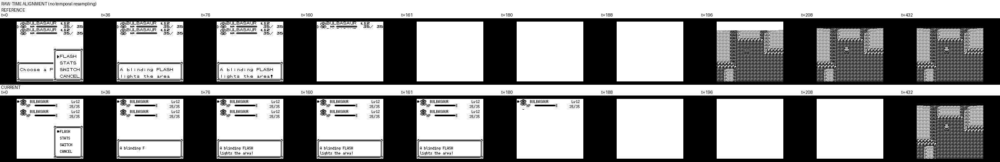

# FLASH 物理显示与音频时序差异审计

日期：`2026-11-13`

## 结论

| 动效 | 录制有效性 | 结果 | 观察 |
| --- | --- | --- | --- |
| RockTunnel1F 普通 SAVE → START → Pokémon → FLASH | 两侧各两轮；逐帧 PNG、输入及 PSG 序列完全复现 | **FAIL** | 阶段顺序相同，但文字、白屏、地图恢复和 PressAB 音效时序均不一致 |

当前 GBA 从选择 FLASH 到首个稳定地图画面需要 **432 帧（7.233 秒）**，原版为
**208 帧（3.482 秒）**，多 224 帧，约为原版的 2.08 倍。两侧帧率均为
59.7275 FPS，差异不是播放速度或录像抽帧造成的。

本结论只判定物理时序，不判定不同分辨率、字体和 UI 布局的像素一致性，也不宣称
已完成逐周期或 audible waveform 对比。

## 录制方法

- Reference：正常零售版 Pokémon Red，非 DEBUG；source commit
  [`fbcf7d0e19a3a2db505440d3ccd3d40ca996c15c`](https://github.com/pret/pokered/tree/fbcf7d0e19a3a2db505440d3ccd3d40ca996c15c)，ROM SHA-256
  `5ca7ba01642a3b27b0cc0b5349b52792795b62d3ed977e98a09390659af96b7b`。
- Current：commit `943385391b3a4167ff242b0b509dd0b365c9ffdc`；默认 release
  GBA ROM SHA-256 `95cf8a69fa0260e21f9d647564115eb0ccd9a0c574313a4db7309239a21743e0`。
  在 `crates/pokered-gba` 构建：

  ```bash
  cargo +nightly-2025-12-07 build --release --locked --offline
  agb-gbafix target/thumbv4t-none-eabi/release/pokered-gba -o current.gba
  ```

- 存档：`docs/audits/2026-10-18/flash-restoration-current-master/fixture.sav`，SHA-256
  `6513e8fa9993de3478d535536f590e47b6ea2a74fdf0116615cc2a74ca463f1c`。
  两侧均从 RockTunnel1F `(15,3)` 普通 CONTINUE 进入，队伍为两只 Lv12 Bulbasaur，
  第一只会 FLASH；没有运行时状态注入、warp、autopilot 或 frameskip。
- 输入：动作菜单选择 FLASH 时为 `t0`；A 在 `t=0,1` 和 `t=160,161` 按住，
  其余时间 neutral。第二次 A 是文字确认。两侧均保留 `t=0..599` 连续物理帧；
  原版另保留 `t=-1` 动作菜单帧。
- Reference：PyBoy 2.9.0，160×144，`sound_emulated=True`，每个 `tick(1)` 对应一个
  emulated frame；每帧记录完整 PNG、状态和 `FF10–FF3F`。
- Current：mGBA 0.10.5 / libmgba，默认 release ROM，240×160；通过 `setKeys`
  输入真实模拟器按键，每帧记录完整 PNG 和 GBA PSG 控制寄存器及 wave RAM。
- 两轮 reference 的逐帧像素和音频序列相同；两轮 current 也相同。所有保留 PNG
  均重新计算并核对了 SHA-256。

原始录制和控制器位于 `.task-tmp/flash-physical-parity-nNYl91/`，不作为版本库
长期材料。compact 数据见 [metrics.json](flash-physical-timing-metrics.json)。

## Raw-time 对齐

没有对任一侧拉伸、丢弃、重复或重采样帧。对比图只把原版画面置于 240×160
黑色画布中，以兼容当前分辨率；所有列都是相同的 `t+N`。

| 指标 | Reference | Current | 差值 |
| --- | ---: | ---: | ---: |
| 文字完整显示首帧 | 37 | 77 | +40 帧 |
| 完整白屏区间 | 161–195 | 188–380 | 起点 +27 帧 |
| 完整白屏时长 | 35 帧 | 193 帧 | +158 帧（5.51×） |
| 白屏后首个地图画面 | 196 | 381 | +185 帧 |
| 首个稳定最终画面 | 208 | 432 | +224 帧 |

“完整白屏”指实际游戏区域内至少 98% 像素为白色；当前 `t=180–187` 的过渡帧仍有
队伍 UI 残留，因此未计入完整白屏。最终画面以 `t=599` 的像素哈希为基准，取该哈希
第一次出现的帧。



原版只读符号 hook 同时观察到：`StartMenu_Pokemon.flash` / `PrintText` 在 `t=0`，
`GBPalWhiteOutWithDelay3` 在 `t=160`，`RestoreScreenTilesAndReloadTilePatterns` 和
`DisableLCD` 在 `t=163`，`EnableLCD` 在 `t=165`，`CloseTextDisplay` 在 `t=195`，
首个恢复后的 `OverworldLoop` 在 `t=207`。这些事件与像素锚点一致。

## PSG 音频时间轴

每帧采样一次寄存器，因此以下是帧级证据，不是逐次写入或逐周期证据。

第二次 A 后，CH1 的 NR12 包络序列在两侧都出现 `91 → 81 → 91 → A1 → C3`，但时间
分布明显不同：

| 指标 | Reference | Current | 差值 |
| --- | ---: | ---: | ---: |
| 确认音效开始 | 161 | 173 | +12 帧 |
| `NR12=A1` 区间 | 164–190（27 帧） | 198–339（142 帧） | +115 帧（5.26×） |
| NR12 回到 `C3` | 191 | 340 | +149 帧 |

首次选择 FLASH 时也不一致：原版 CH1/NR12 在 `t=1` 开始变化；当前 CH1 直到确认
时的 `t=173` 才变化，而当前 CH2/NR22 在 `t=12–22` 发生变化。

触发前的混音状态已经不同：原版 `NR50/NR51/NR52 = 77/33/F3`，当前对应值为
`77/BB/8F`。这是进入 FLASH 前就存在的路由/通道状态差异，不能归因于本次 FLASH
操作；应另开普通地图音乐基线审计。寄存器状态差异本身不等同于已证明的 audible
波形差异。

## 实现侧交叉检查

原版 [`StartMenu_Pokemon.flash`](https://github.com/pret/pokered/blob/fbcf7d0e19a3a2db505440d3ccd3d40ca996c15c/engine/menus/start_sub_menus.asm)
依次清除暗地图 palette offset、打印文字、调用 `GBPalWhiteOutWithDelay3`，随后经
`.goBackToMap` 执行 `RestoreScreenTilesAndReloadTilePatterns` 和 `CloseTextDisplay`。
录制观察到的原版阶段与该例程一致。

当前入口位于 `crates/pokered-app/src/field_flash.rs:245`，文字推进位于
`crates/pokered-app/src/field_flash.rs:431`，恢复调度位于
`crates/pokered-app/src/field_flash.rs:510`；VBlank、显示预算及音频 continuation 位于
`crates/pokered-app/src/field_flash_irq.rs:345`。PressAB 流由
`crates/pokered-audio/src/source_clock/press_ab_work.rs:28` 处理。

现有数据能证明运行时结果不同，但还不能单独证明是宿主吞吐不足、显示预算分配还是
音频调度导致。不得用源码常量一致或最终画面一致推翻上述 raw-time 结果。

## 后续建议

1. 在当前 GBA 上对文字、白屏、pattern copy、VBlank 和 `SourceAudioFrame` 分段测量
   实际硬件周期，先定位 `188–380` 白屏和 `198–339` 音效末段分别消耗在哪里。
2. 对原版 palette/APU 写入和当前 GBA 写入增加带时间戳的追踪，区分“固定调度错误”
   与“宿主执行不足导致物理帧滑动”。在此之前不修改产品逻辑。
3. 另测普通 RockTunnel 音乐的初始 `NR51/NR52` 基线，避免与 FLASH 自身差异混合。
4. 后续修复必须重跑本场景两轮及完整的 600 帧窗口；通过门槛应包括阶段时长、
   音频包络序列和最终状态，而不只是最终截图。

## 后续进展

- **PR #458（`6fe2e7c3`）物理时序收敛**：在相同 `RockTunnel1F` 存档与 600 帧双轮 mGBA 实测下，文字完整显示首帧由 `t=77` 收敛至 `t=39`（相对原版 `t=37` 仅 `+2` 帧），完整白屏由 `193` 帧缩短至 `37` 帧（相对原版 `35` 帧仅 `+2` 帧），确认音效 `NR12` 回到 `C3` 达到 `t=191`（与原版 `0` 帧偏差），首个稳定最终画面由 `t=432` 收敛至 `t=213`（相对原版 `t=208` 仅 `+5` 帧）。
- **普通地图音乐 `NR51` 基线修复（Tier-2）**：定位到 `NR51 = 0xBB` 源于 `gba_psg::initialize()` 初始写入 `0xFF` 且 `AudioManager::play_music` 切歌时未清除非 SFX 通道的 `NR51` 路由位，导致标题画面残留的 CH4 位（`0x88`）在 `MusicId::DUNGEON3` 开场休止期间未被清零（`0xFF & !0x44 = 0xBB`）。现已在 `AudioManager::play_music` 切歌时按 `Audio*_DisableMusicChannels` 清理非 SFX 音乐通道的 `NR51` 路由位并关闭对应 DAC，同时将 `gba_psg::initialize()` 初始 `NR51` 改为 `0x00`，使 `DUNGEON3` 开场实测 `NR51 == 0x33` 与原版一致。
- **剩余边界**：`NR52` 高三位（bits 4–6）在 DMG 硬件恒读为 `1`（`0xF3`）而在 GBA `SOUNDCNT_X` 恒读为 `0`（`0x83`）属硬件差异；此外上述单元测试证明逻辑/寄存器路由修复，不替代新一轮 mGBA/PyBoy 600 帧端到端物理音频波形对照。
