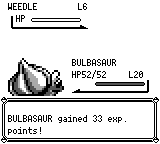
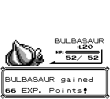

# Battle participant EXP masks — audit 867

首发参战宝可梦实际昏倒、换入健康成员击败同一敌人时，修复前仍把昏倒成员计入经验分母。常青森林第一个捕虫少年（Weedle 6、Caterpie 6）使健康 Bulbasaur 得到 33 + 67 = 100 EXP；原作及修复后是 66 + 67 = 133 EXP。成长值也恢复完整份额。

本改动维护原作两组参加标记，而不是在经验分母里统一排除 HP0：

- 初次出场、普通/强制换人：设置 gain 与 fought。
- `RemoveFaintedPlayerMon`：只清除昏倒成员的 gain，保留 fought。
- 同一敌人战斗中 Revive/MaxRevive：仅 fought 已设置时恢复 gain。
- `GainExperience.done`（包括没有 gain 位时）、敌人换入：清空两组并设置当前在场成员。训练家 AI 和 link 的 `SwitchEnemyMon` 最终也调用 `EnemySendOut`。
- SHIFT 免费换人：原作在新敌人出场后再次清空两组，随后只设置被选择成员。

`gain_experience` 已有的 still-flagged HP0 分母规则保留；一个仍被标记的 HP0 成员依旧计入分母、但不获得经验。修复在实际生命周期边界移除其资格。未修改经验公式、EXP ALL、战斗效果栈、伤害、招式学习或字体/布局。

## 原作与实际菜单

原作 source revision `fbcf7d0e19a3a2db505440d3ccd3d40ca996c15c`，零售 ROM SHA1 `ea9bcae617fdf159b045185467ae58b2e4a48b9a`、PyBoy 2.8.1。原作依据：`engine/battle/core.asm` 的初次出场、`RemoveFaintedPlayerMon`、`ChooseNextMon`、`SwitchPlayerMon`、`EnemySendOut`、SHIFT 尾部；`engine/battle/experience.asm:278` 的 `.done`；`engine/items/item_effects.asm:932–950` 的复活参加资格。规则来自原作 ASM，与实际按键证据分别保留。

两名成员均为合法 Bulbasaur、DV `9a78`、成长值 0、OT/player ID 0、未交换、无徽章。弱成员等级5、HP1/20、EXP135、Tackle/Growl、PP35/40；健康成员等级20、HP52/52、EXP5460、合法 Cut/BodySlam/TakeDown/DoubleEdge、PP30/15/20/15。SET/Fast；没有 EXP ALL；初始3000元。

原作地图准备从已保存的场外 state 加载，以准备阶段的 EI/JP 进入原作 `EnterMap` 完整加载地图/地图头/精灵/图块，在 passable `(28,32)` 完成队伍、ID、背包、选项构造，保存 `constructed-start.state`。此准备不进入战斗/经验函数；从该边界开始仅普通按键与只读 hook。复刻从同义 JSON、私有 binary/cwd/SAVE、启动参数 `--warp ViridianForest,28,32` 引导；没有启动后 warp 或状态写入。实际 Down 按键走到 `(28,33)`，被 NPC2 捕虫少年看到，真实对话进入真实训练家战斗。

四种流程各原作两次、复刻修复前/后各两次，共原作8次、复刻16次。每次都从初始构造启动、正常战斗、从 START 菜单普通 SAVE，再读物理 SRAM；复刻另 import-snapshot 读回。所有 checksum 有效。重复的 fixture/input/state/PNG/SRAM 字节一致；复刻前/后 fixture 和按键/帧预算一致。

| 实际流程 | 原作最终 EXP（弱 / 健康） | master906 修复前 | 修复后7834 |
| --- | --- | --- | --- |
| 实际昏倒 → 换人 → 不复活 | 135 / 5593 | 135 / 5560 | 135 / 5593 |
| 健康成员单独战斗，弱成员从未出场 | 135 / 5593 | 135 / 5593 | 135 / 5593 |
| 弱成员被 KO，换人后对同一 Weedle 使用 Revive | 168 / 5560 | 168 / 5560 | 168 / 5560 |
| 弱成员被 KO，击败 Weedle 后对 Caterpie 时才 Revive | 135 / 5593 | 135 / 5560 | 135 / 5593 |

不复活时，原作真实 hook 显示 `gain=1/fought=1` → 昏倒 `gain=0/fought=1` → 换人 `gain=2/fought=3` → 给健康成员66 EXP。同敌人复活使 `gain=2/fought=3` 恢复为 `gain=3/fought=3`，两人各33 EXP。换到下一只敌人后复活时，原作 `gain=2/fought=2` 保持不变，弱成员没有参与 Caterpie，EXP135不增。复刻 debug snapshot 不导出这两组 mask；其证据是实际消息、普通 SAVE 的 EXP/成长值以及生产调用链，未把静态推断说成动态读取。

不复活、solo、下一敌人复活三个流程，原作与修复后的两名队伍成员 SRAM 共88字节完全一致（含 catch-rate byte7/51，不排除字节）。健康成员成长值为 `[85,65,65,95,40]`；不复活修复前是 `[65,47,50,70,30]`。同敌人复活的 EXP、成长值、弱成员HP10、招式、PP、消费一致；原作健康成员HP50，复刻修复前/后均HP52。这次原作 RNG 与复刻 seed42 不做逐抽取对齐，不断言跨引擎自由回合伤害一致；这个HP差别未被本修复更改。其余87字节一致。

所有流程最后弱成员 PP35/40、健康 PP28/15/20/15；带 Revive 的流程恰好消费初始1个，没有 Revive 的背包保持空。所有原作/复刻 SAVE 金额均3000→3060。旧 audit863 总结布尔字段一度误写3120，和其原始 trials/readback3060冲突，已加 erratum；原始 capture 未变。本报告金额从 SRAM/JSON 读取断言。

## 同屏同帧截图与构建身份

下面两张是相同 fixture、相同按键、相同 battle phase、frame1488。只是 EXP 数字33→66。

前（clean master `906ae8f82d05006691c5aca3cb9cb2fc67b035c7`）：

后（clean `7834bff8da0413f2756f1126736410adc8293eda`）：

原作参考，独立模拟器 frame，不用于替代 native before/after：

BEFORE `audit-865-stone-hints-before-debug` SHA256 `b50130e04db566195707c8c48fa57746fe71d34d8f9c0a3c62883e19c901c2bb`，debug-server / dev opt0 debug0。AFTER `audit-867-exp-participants-after-debug` SHA256 `2c156369f624ee84d64dbbcdc85e54398c980b246c43d8ad387987728f060b6a`，debug-server / dev opt2 debug0。

全部测试/构建/实际捕获终结后合入 master `e481388da39ab702480779bcb191f4ca8dc5772a`（只有 Stats FNT renderer/tests/docs）。这四个 core 修复文件和冻结7834的 Git blob 完全一致；该 Stats 页不在本次战斗/道具选择流程中。没有把旧截图或旧测试标成更晚构建。

## 校验与可复验资料

- `cargo test -p pokered-core --lib`：2867 passed，0 failed；内含9个参加标记边界测试，另保留 still-flagged HP0 的原作 DIV 回归。
- `cargo build --bin pokered-app --features debug-server`：PASS，随后私有冻结 binary。
- master e481 合入后，使用相同冻结7834 test executable 重跑9个专项：PASS；未再占用共享 Cargo target。
- [verification.json](verification.json)：每次真实输入/run directory、源码/脚本/fixture/binary/SRAM/hash、checksum、各阶段原作 flags、最终 EXP/成长值/HP/PP/背包/金额、同帧与字节比较。
- [fixture-no-revive.json](fixture-no-revive.json) 是完整现代 JSON 基础构造；[replay-native.py](replay-native.py) 在启动前派生 solo / revive / revive-next。运行参数为 `CASE REPEAT before|after FROZEN_BINARY EXACT_SOURCE_COMMIT`；需要 `scripts/debug_drive.py` 与 `LD_LIBRARY_PATH=/tmp/pokered-build-lib`。例：`python3 docs/audits/battle-exp-participant-flags/replay-native.py no-revive 1 after /path/to/frozen-app 7834bff8da0413f2756f1126736410adc8293eda`。
- [prepare-original-map-audit.py](prepare-original-map-audit.py) 与 [replay-original-audit.py](replay-original-audit.py) 保留原作实测脚本原文（后者 SHA 与 revive-next 原始记录一致）。这些审计脚本使用记录中的本地零售 ROM、symbol、PyBoy bootstrap/base map state；源 ROM/state 不提交到仓库。原始所有 run artifacts 保留在 `.task-tmp/fidelity-39-plus/audit-863-*` / `audit-867-*`。

实际覆盖为敌人攻击导致首发昏倒、强制换人、同/下一敌人 Revive、普通 SAVE。simultaneous faint 测试只校验经验前清 gain，不宣称验证或修正原有同时昏倒换人阶段顺序。SHIFT、训练家 AI 换人为原作静态规则与专项测试覆盖；link mask reset 经静态调用链审查与现有全核心 link 测试，未新增直接检查 link mask 的专项或真实 link 录制。未作相同场景全部真实菜单录制。Revive-v1 曾在复活成功后因保留 ITEM 光标重复打开空背包，该未完成 SAVE 的尝试不计通过；v2/v3 用真实 Up/Left 返回 FIGHT 后完整完成。
