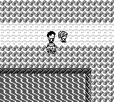
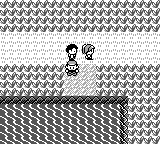

# CUT clears the grass block

Using CUT on natural Route 6 grass previously displayed the success text and
grass particles but left the grass intact. The original sends grass through
`ReplaceTreeTileBlock`, just as it sends trees through that routine. Its
`CutTreeBlockSwaps` contains `0B → 0A`: the former block has sixteen grass
tiles `52`, and the latter has sixteen ordinary ground tiles `2C`.

The correction supplies that existing lookup to `PendingCut` for grass.
The existing text, deferred replacement, grass particle kind, SFX and
missing-table-entry behavior remain in place. No other field move changes.

## Actual menu, walking and SAVE evidence

The original reference archive is identified by revision
`fbcf7d0e19a3a2db505440d3ccd3d40ca996c15c`; it has no Git metadata. The compiled
symbol source and the archive have identical SHA-256 hashes for CUT, the
swap table, the overworld blockset, Route 6 blocks and wild encounter code.
The retail Red ROM's SHA-1 is recorded in [verification.json](verification.json).

Construction precedes the validation boundary. Source `EnterMap` initializes
the natural Route 6 map at `(10,22)`; two legal Lv12 Bulbasaur then have DV
bytes `9A78`, zero StatExp, EXP 973, catch-rate byte 45 and cached stats
35/18/19/17/22. The first knows Tackle, Growl, Leech Seed and CUT, with PP
35/40/10/30. Its HP is either 35 or 0; the second is healthy with Tackle and
Growl. The Cascade Badge is present, cash is 3,000 and the bag is empty.
All six Route 6 trainers are marked defeated before validation to permit the
connection control without a required trainer battle. Native construction
uses the committed healthy/fainted JSON fixtures and equivalent campaign
facts. Each run has its own binary copy, working directory and SRAM path;
there is no legacy sidecar.

Each healthy and fainted case runs twice on each native build and twice on
the original. Inputs use START → POKéMON → CUT, acknowledge the actual text,
wait for the animation and walk down onto `(10,23)`. No validation-time RAM
writes, debug setters, direct CUT call or scripted completion is used.

| Observation | Original | Native before | Native after |
| --- | --- | --- | --- |
| Target block before CUT | `0B` | `0B` | `0B` |
| Target block after CUT | `0A` | `0B` | `0A` |
| Ground on the next real step | `2C` | `52` | `2C` |
| Block after leaving and reentering Route 6 | `0B` | `0B` | `0B` |
| Saved first Pokémon HP, healthy / fainted | 35 / 0 | 35 / 0 | 35 / 0 |

The original's cached standing tile still reads `52` immediately after CUT;
the next real step refreshes it to `2C`. Native tile predicates are derived
from the actual debug-reported map block and the blockset, with a core test
also exercising `determine_encounter_type`: all four positions in the
cleared block become ground with no grass encounter type.

After CUT, real walking follows `(14,23) → (14,29) → (9,29) → (9,34)` and the
south Route 6/Vermilion City connection, then returns through the north
connection. The original continuations load genuine captured after-CUT
states; their validation window also contains no RAM writes. Each complete
flow finishes with ordinary START → SAVE → YES. Independent SRAM readback
validates the main checksum and all **88 party bytes**, including catch rate,
against the constructed original party. HP, stats, EXP, StatExp, move PP,
healthy partner and cash are unchanged. Source checksums are 208/243 and
native checksums 16/51 for healthy/fainted cases; whole saves are not claimed
identical.

No wild battle occurred in these recorded routes. This verifies terrain and
encounter eligibility, not identical random encounters or full animation
cadence. Source and native input clocks are different and are not presented
as frame-aligned emulator recordings.

## Native build and frame identities

The comparison was captured while `db250c03` was master, before the later
participant EXP fix was merged:

| Build | Exact production source | Binary SHA-256 |
| --- | --- | --- |
| Before | `db250c03efa4be2161cb289a1591ac9fd71f6ac1` | `087e37e881621584abb2238345e2e9f23682664b8ede24468eb8117c1456ce32` |
| After | `64ba9dfda5fb2e70b9701272a11bd868e66bd204` | `eb3530078850c8eea7e4f852a4c0afaf1af6920365a537b99f076f47a2bff9fd` |

Both use a dedicated W883 Cargo target, `dev opt0debug0` and `debug-server`.
Full source/manifests hashes are archived in the before/after build identity
files. Later branch updates do not relabel these frozen binaries or captures.

Native actions match across before/after and across repeats. CUT completes
at frame 580, the next tile is captured at 628, city entry at 1,316, Route 6
return at 1,364 and the completed SAVE at 2,452. Every stage's PNG is
byte-identical between the two repeats for each build and health case.
The same-screen/frame before/after pairs below were visually inspected:

These original images are additional source references, not native
before/after replacements:

## Regression coverage and evidence limits

Two new core tests cover the natural target block, deferred text/animation
boundary, healthy/fainted users, preservation of the grass particle kind,
the four cleared ground predicates, a single CUT SFX and the missing-badge
control. At corrected source `64ba9dfd`, both selected tests pass and the
complete core suite passes **3,279 tests** (2,867 library + 412 integration),
with one documentation example ignored. The `debug-server` app build and
`git diff --check` also pass. Local logs retain those source identities.

[verification.json](verification.json) contains actual action traces, source
routine observations, map/party observations, fixture/binary/script/PNG/SRAM
hashes and raw evidence directories. The three capture scripts are archived
verbatim with their actual hashes; they retain explicit local reference and
earlier fixture dependencies. This is a bounded CUT scenario, not a fresh
main-line completion claim.

Rejected preparation/navigation attempts are retained in the private audit
directory: an incorrect party phase assertion, wrong fixed SAVE-menu offset,
the northern one-way ledge, a southern lake/wall, and a continuation loading
the older fixture without defeated-trainer flags. None is counted as a
passing control or a CUT regression. The successful manifests supersede
those attempts without deleting their logs.
