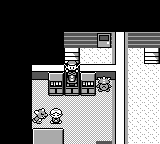
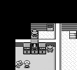
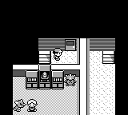

# Automatic doorway step collision

This isolates the gameplay fix from PR #107 commit
`acb42de40129f4224e090251cfcee907885564ba` and adapts it to the current field loop.

In Celadon Mansion's back stairwell, descending from 2F to 1F placed the player
on `(2,1)`, then the unconditional automatic DOWN moved them into the wall at
`(2,2)`. The same path ignored NPCs below a doorway.

Original reference: `pret/pokered@fbcf7d0e19a3a2db505440d3ccd3d40ca996c15c`.
[`PlayerStepOutFromDoor`](https://github.com/pret/pokered/blob/fbcf7d0e19a3a2db505440d3ccd3d40ca996c15c/engine/overworld/auto_movement.asm)
queues one DOWN input. `JoypadOverworld` decrements its index from 1 to 0 before
`CollisionCheckOnLand`, so the automatic step still checks walls and sprites.

Use the regular collision check for this step, including NPC current and walking
destination positions. Keep the existing first two pixels and redraw wait for a
clear doorway. A blocked step is consumed once and returns control to the player.

## Verification

- The two new regression tests fail on `523b82c0`: Mansion1F reaches `(2,2)`
  instead of `(2,1)`, and an NPC does not block the automatic step.
- After the fix, all three Mansion floors stop above the wall and permit a
  subsequent rightward move. The NPC case blocks once even when the NPC is
  removed afterward. The clear-exit case preserves the initial walk counter.
- Combined with #376, the complete core suite passes: 3,664 tests, 0 failures,
  1 existing ignored documentation test.
- Native debug-server build, default release GBA build, and all seven original
  GBA performance scenarios pass. Baseline, thresholds and timeouts are unchanged.

Native screenshot sequence: explicit startup warp to `CeladonMansion2F,3,1`,
seed 42, driven-only input, LEFT for 16 frames and neutral for 144 frames.
The actual stair warp then reaches 1F. The before binary is frozen `af6a12f8`;
its overworld/map source is identical to the #376 base. The after binary includes
#376 plus this patch. Hashes and measurements are in `verification.json`.

| Before: pushed into wall | After: remains on stair |
| --- | --- |
|  |  |

A further RIGHT for 16 frames and neutral for 32 frames ends at `(3,1)`, idle:

This is an isolated input test using a startup warp and an empty temporary save,
not ordinary mainline evidence or an original-ROM physical-input recording.
The unrelated Ghost battle handoff change from #107 is not included: a separate
held-LEFT, menu-RUN diagnostic already returned correctly on the current base.
