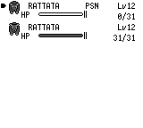
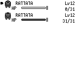

# Field poison fainting status

When a living poisoned Pokémon drops from 1 HP to 0 HP after an overworld step, the original clears its complete status byte before displaying the fainted message. The port retained `Poison` and wrote that stale status to the next ordinary SAVE. This change clears the status at that exact HP transition. Already-fainted entries and surviving poisoned entries keep their existing status.

## Actual input and persistence evidence

The final scenario uses two Normal-type Rattata at level 12, with standard calculated stats/DVs and legal learned moves Tackle, Tail Whip and Quick Attack. The first has 1 HP/Poison; the healthy bench has 31 HP. Party, map and status are constructed before the first input. Validation then uses four single walking steps in Red’s bedroom, ordinary text acknowledgement and START → SAVE → YES; it never writes validation-time game state. This does not claim natural capture/poison infliction, travel through the entire campaign, or reachability of every inherited template flag.

Each original/before/after trial is repeated twice:

| Build | Normal SAVE outcome | Party comparison with original |
|---|---|---|
| Original Red, source `fbcf7d0e` | first 0 HP / status 0; bench 31 HP / status 0 | reference |
| Current master `fcbcd10c`, before | first 0 HP / Poison; bench 31 HP / None | only offset 4 of 88 party bytes differs |
| Fix `24ab208a`, after | first 0 HP / None; bench 31 HP / None | all 88 party bytes match |

All six ordinary SRAM files have valid main checksums. Native PP, stats, experience, DVs, catch-rate and every supplied party field outside HP/status stay intact; box, PC storage, bag, Pokédex and cash 3000 also stay intact. Original party bytes outside HP/status remain unchanged. Separate OT/nickname storage and whole 32 KiB cross-engine equality are outside the 88-byte claim.

Primary code: `engine/events/poison.asm`, lines 41–46, clears the status immediately after HP reaches zero. The retained original state, raw SRAM and readonly hooks show this happening through real walking, rather than a direct call to that routine.

## Screenshots

Reload each actual ordinary SAVE output, then use the same START/Pokémon inputs. Both screenshots are frame 244; repeat pixels and actions are identical within each build. The before executable was rebuilt from clean current master `fcbcd10c`; the after executable is clean `24ab208a`. Hashes are in `verification.json` and the archive’s build identities.

前：

后：

The separate HP-zero FNT-priority UI repair was merged as PR #242 (`64ef04af`) after these captures. The screenshot and archived report identities preserve their capture-time context. This PR clears the stale saved status.

## Regression and limits

The new regression fails once against unchanged baseline production code, then passes with the fix. It checks newly fainted, already fainted, surviving poisoned and healthy entries together, comparing the complete party and preventing extra HP/PP/stat changes or a blackout while survivors remain.

After integration with master `fcbcd10c`, `cargo test -p pokered-core` passes **3,294 tests** (2,882 library and 412 integration); one documentation example is ignored. The debug-server application builds successfully. Baseline setup failures from the wrong gfx link and argument placement were rejected before the test ran; they are preserved locally and do not count as game regressions.

Multiple fainted messages, per-mon damage/acknowledgement ordering, the poison palette flash and blackout confirmation are independently tracked continuation work (896). Earlier constructed Bulbasaur/Poison trials remain private generic loop controls with an explicit reachability erratum: original PoisonEffect rejects Poison-type targets. They do not replace the Normal-type Rattata evidence here. Earlier 729 before captures keep their original identities and are not relabelled as the current-master screenshots.

`evidence.zip` contains the six final walking/SAVE controls, paired party captures, raw states/SRAM, inputs, readbacks, PNGs, logs, build hashes and the original capture scripts. All 575 members were read back and checked against `evidence-entry-manifest.json`. No ROM or executable is included. Scripts retain their historical private paths as provenance and require path/ROM/binary setup to run elsewhere; the archive is evidence, not a portable public one-command runner.
