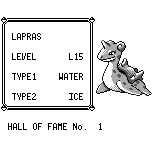
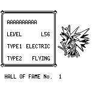

# Hall of Fame PC: finish each cry before reading buttons

The previous viewer accepted A/B while its current Pokémon's cry was playing.
A could immediately replace that Pokémon and start the next cry; B could exit.
The original waits for the cry before reading either button. The earlier claim
in `docs/fidelity-pc-audio-42-45.md` that the original did not wait was incorrect.

The viewer now starts the existing sound wait for each displayed Pokémon. Its
live held-input path preserves the PC caller's sampled button history during
the wait, then reads new presses at the next actual foreground poll. This also
preserves the difference between a released short pulse and a button held
through the end of the cry. No game-state or audio-busy flag is forced in the
actual recordings or cold PCM tests.

## Original controls

The pinned original is `pret/pokered@fbcf7d0e19a3a2db505440d3ccd3d40ca996c15c`.
[LeaguePCShowMon / LeaguePCShowTeam](https://github.com/pret/pokered/blob/fbcf7d0e19a3a2db505440d3ccd3d40ca996c15c/engine/menus/league_pc.asm)
returns from [HoFDisplayMonInfo](https://github.com/pret/pokered/blob/fbcf7d0e19a3a2db505440d3ccd3d40ca996c15c/engine/movie/hall_of_fame.asm)
before calling WaitForTextScrollButtonPress. Its tail-called
[PlayCry](https://github.com/pret/pokered/blob/fbcf7d0e19a3a2db505440d3ccd3d40ca996c15c/home/pokemon.asm)
ends with WaitForSoundToFinish. The later button poll uses hJoy7=0.

All four controls normally boot the original, choose CONTINUE, physically walk
from Viridian City to its Pokémon Center PC, and open the Hall of Fame. Hooks
only read execution sites and memory. Each control was independently repeated
twice with exactly matching input tapes, events and observations:

| Input during the first cry | Original result |
|---|---|
| A for one frame, then release | Keep Zapdos; a later A after the cry selects Lapras. |
| B for one frame, then release | Keep Zapdos; a later A after the cry selects Lapras. |
| Hold A through the end | Keep Zapdos, retaining the caller's sampled A history; a sampled release followed by A selects Lapras. |
| Hold B through the end | Exit at the subsequent button read after the cry. |

For the short-A control, the cry begins at frame 3333; frames 3335/3337 retain
Zapdos with active cry channel IDs. The caller reaches its acknowledgement
wait at frame 3378, and a later A selects Lapras. These are original observations,
not original/native frame or RNG parity claims. No original-font images or ROM
copies are bundled.

`original-controls.json.gz` contains the physical tapes, readonly hook events,
and named observations. The independent `replay-original.py` reproduced all
four cases exactly (`original-replay.json.gz`). It requires PyBoy 2.8.1 and a ROM
with SHA-256
`5ca7ba01642a3b27b0cc0b5349b52792795b62d3ed977e98a09390659af96b7b`
and its matching `pokered.sym`.

```sh
uv run --python 3.12 --with pyboy==2.8.1 python \
  docs/audits/hof-pc-cry/replay-original.py \
  --rom /path/to/reference.gbc --sym /path/to/pokered.sym \
  --fixture docs/audits/hof-pc-cry/original-fixture.sav \
  --controls docs/audits/hof-pc-cry/original-controls.json.gz \
  --out /path/to/new-original-result.json.gz
```

Both SRAM inputs are explicitly offline fixtures, not fresh playthroughs.
`fixture-provenance.json` records their base hashes and mutations: the Hall of
Fame window comes from the natural ending save of the earlier fresh m01–m49
run, with the HoF counter/Pokédex event and checksum updated offline. The
original fixture retains its coherent Viridian map/actor data; the native
fixture retains its Pewter Pokémon Center data at `(13,4)`. No runtime setters,
warp, snapshot restore, debug save, or forced RNG output is used.

## Same-frame native comparison

Both recordings normally boot, choose CONTINUE and enter the Pewter PC with
seed 42 supplied at process startup. They replay the same entire 877-frame
physical input tape, with the same 58 state observations and identical player,
phase and frame schedules. SRAM bytes stay unchanged. Source files, HEAD and
the sole game binary stay frozen throughout each recording.

| Observation | Merged master `67afd59f` | Code `1ff8ee73` |
|---|---|---|
| Frame 778: first cry | Zapdos, cry 43 playing | Identical picture and cry |
| Frame 779: early A | Lapras, cry 46 playing | Keep Zapdos, cry 43 playing |
| After 96 neutral frames | Sound ended | Sound ended |
| Frame 876: fresh late A | Advance to the third Pokémon | Select Lapras, cry 46 playing |

The fixed early-A picture exactly equals the original first picture. Its
later-A picture exactly equals the old second picture, proving advancement
still works after the wait. `comparison.json` and `native-before.json.gz` /
`native-after.json.gz` preserve the complete comparison and raw observations.
Whole screenshots show absolute frame 779:

Before:



After:



Build each version into the usual shared target, record before, then rebuild
the same binary path for after. The replay script needs only the standard
library and the repository's normal driver:

```sh
python3 docs/audits/hof-pc-cry/replay-native.py \
  --repo "$PWD" --binary /path/to/sole/pokered-app \
  --fixture docs/audits/hof-pc-cry/fixture.sav \
  --role after --out /path/to/new-after-recording
```

## Regression scope

At code commit `1ff8ee7330b31f6db204b7e8b684bd0821f7f70f`, all 3636 core tests
passed (one existing ignored doctest), all 402 app tests with `debug-server`
passed (40 existing ignored tests), and the normal CLI built successfully.
The four new controlled core tests and two cold SRAM/real PCM tests are included
in those totals. The PCM tests normally boot and use real input and actual
sequencer completion, including short A/B, held A/B and the next cry. They do
not manually change the screen, PC phase or sound-busy state. The standalone
original replay also passed all four controls.

The latest base master has a completed fresh m01–m49/ending/separate-process
CONTINUE regression. That earlier run is not relabeled as a new HoF-fix run;
this change is covered by the complete PC controls and full core/app tests.
This audit establishes cry ordering and input sampling, not complete PC palette,
loading, instruction, raster, or whole-game parity. All original CI jobs remain
required before merge.

## Full-store stress follow-up

The first GBA CI stress run exposed an outdated test assumption: the driver
counted an A pressed during the cry as a visited record, although that A is now
correctly ignored. It now waits for the actual viewer's sound wait to finish
before checking the expected species and sending A. The original 300-record
check, species order, 16-frame input cooldown, 18,000-frame bound, heap/stack
thresholds and final full-store SRAM checks remain intact.

A third cold-boot app test constructs the 50-team/6-member SRAM offline, boots
normally and visits all 300 records with real cries in 15,850 frames. All three
HoF app tests pass (`full-store-tests.log.gz`). The broad GBA scenario ROM also
passes all 13 cases, including 330 move animations, 300 HoF records and the
full-store SRAM save/reload (`gba-memory.log.gz`). Minimum contiguous heap is
4,416 B and untouched stack is 8,724 B, both above the unchanged 4,096 B gates.
This is a controlled stress fixture, not original/native frame timing parity.

The follow-up changes only tests, the stress driver, its resolved GBA lockfile
and these records. The player-facing cry fix and previously recorded native
before/after product sources are unchanged. `validation.json` preserves the
checks and exact source/ROM hashes used by the local stress run.
