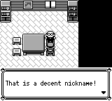
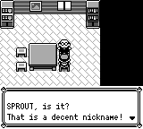
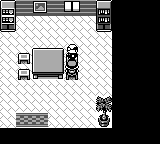
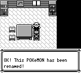
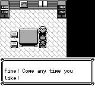

# 名字评定师：取消分支与昵称台词

修复名字评定师四处玩家可见差异：评级提示补回所选宝可梦的当前昵称；空名字提交取消后告别；队伍选择取消后告别；成功改名时在确认文字中显示新昵称。

原作依据为 pret/pokered `fbcf7d0e19a3a2db505440d3ccd3d40ca996c15c`：

- `scripts/NameRatersHouse.asm`：队伍菜单取消、命名菜单取消都跳到 `.did_not_rename`，打印 `ComeAnyTimeYouLikeText`。
- `engine/menus/naming_screen.asm:DisplayNameRaterScreen`：首字节为终止符的空名字置 carry 并返回，成功时复制名字到队伍。
- `text/NameRatersHouse.asm`：评级文字先输出当前昵称及 `, is it?`；确认文字在 `renamed` 后输出新名字。

实际截图基线来自检出的 master `7a1659aefe0cfd754c1c7647b2b63817cae78e96`；修复内容提交 `d866ee66`，之后集成了已全绿合入的 master `ea6833c5`。`comparison.json` 保存两侧二进制、场景和夹具身份，以及完整图像差异信息。

## 实际输入和保存验证

使用离线构造 SRAM：玩家位于 `NameRatersHouse (5,4)`，以按键向上面对 `(5,3)` 的名字评定师，队伍第一只宝可梦是自己拥有的 `SPROUT`。每次都正常启动、CONTINUE，随后用实际菜单、命名和 SAVE 按键完成流程。判定期间仅使用只读观察、截图和 `press_timeline`，没有运行时设值、warp、skip_dialogue 或 restore。

| 场景 | 修复前 | 修复后 | 实际 SAVE 的昵称 |
| --- | --- | --- | --- |
| 选择宝可梦后的评级 | 直接说 That is a decent nickname | SPROUT, is it? 然后继续评级 | SPROUT |
| 队伍菜单 B 取消 | 直接结束 | Fine! Come any time you like! | SPROUT |
| 空名字提交取消 | 仍说已改名 | Fine! Come any time you like! | SPROUT |
| 输入 A 并提交 | 确认文字省略名字 | 确认已改名为 A | A |

三条输入路线在基线和修复版各执行一次，全部驱动退出码为 0。对每一条路线，初始完整状态、打开的队伍画面完全一致，保存后的整个队伍 SRAM 区域 `0x2f2c..0x30c0` 也一致。所有保存均核对校验和与昵称字节；并非从不包含昵称的 `get_party` 返回值推断改名结果。

取消后保留 `SPROUT`、成功后写入 `A` 的两份实际存档，又分别由独立进程正常 CONTINUE 并再次评级，实际文字分别读出 `SPROUT, is it?` 和 `A, is it?`。随后选择 NO 返回地图。两次都未改变载入的存档。可移植脚本另验证默认空名字路线，以及集成最新 master 后载入实际 `A` 存档的路线。

## 同帧前后截图

在队伍/命名控件已打开之后，显式空等到第 2000、5000、5200 帧再施加相应输入，以便在相同实际帧号截图。全部空等均保留在命令轨迹中，没有移帧、丢帧或重采样。这是剧情分支和静态画面验证，不是动画时序 PASS。

评级首屏，第 2183 帧：




队伍菜单取消，第 2183 帧：




空名字取消，第 5183 帧：




成功改名，第 5383 帧：


两侧均有文本窗口的对照中，窗口上方 `(0,0,160,96)` 地图区域逐像素相同。队伍取消对照在旧版已结束对话、新版仍显示告别窗口，完整图像和其差异同样保留；不据此赋予背景/动画一致性结论。

## 核心回归和重放

新增七个真实内嵌场景分支测试。修复前恰好四个新测试失败，其余三个通过；失败分别对应上述四处差异。修复后 12 项名字评定师相关测试通过，核心库全量 **3179 通过、0 失败、0 ignored**。接入最新 master 后再次运行 12 项相关测试及 debug-server 构建，通过。覆盖评级 NO、改名 NO、队伍取消、空名字取消、成功写入一次、所选昵称提示和外来宝可梦保护。

`*.json.gz` 保存完整按键请求、页面和状态；`*-actual-save.sav` 是实际 SAVE 的产物；`*-continue.json.gz` 是独立进程验证；压缩日志保存测试原始结果。`SHA256SUMS` 覆盖本目录所有文件。

```sh
cargo build -p pokered-app --features debug-server --bin pokered-app
python3 docs/audits/name-rater-flow/replay.py --output /absolute/path/to/new-empty --case empty --binary target/debug/pokered-app
python3 docs/audits/name-rater-flow/replay.py --output /absolute/path/to/new-rename --case rename --binary target/debug/pokered-app
python3 docs/audits/name-rater-flow/replay.py --output /absolute/path/to/new-party-cancel --case party-cancel --binary target/debug/pokered-app
```

输出目录必须尚不存在。旧版可指定 `--version base`。载入实际改名存档可增加 `--fixture docs/audits/name-rater-flow/rename-actual-save.sav --original-name A`，并选 `--case empty`；输入文件会被复制到输出目录，实际 SAVE 写入该副本。

验证边界：夹具预置地点和队伍，不能据此宣称从野外旅行到达或重新捕获该宝可梦。外来宝可梦和两个 NO 分支有核心测试，实际菜单录像只覆盖表中三条路线及两个存档 CONTINUE。原作依据来自脚本与文本源，没有原作模拟器对话录像。本证据不代替全游戏覆盖、GBA 界面验收或最新 master 的 fresh 全流程通关。
