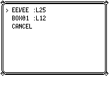
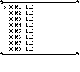
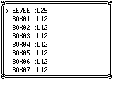

# 新收宝可梦入盒顺序

满队伍时，原作把赠送或捕获的新宝可梦放在当前 BOX 第一格；复刻此前追加到末尾，普通保存后 PC 列表也保留错误顺序。修复只让新收到的宝可梦进入第一格，已有记录保持顺序。

| 流程 | 原作入口 | 修复后的入口与顺序 |
| --- | --- | --- |
| 收礼物，队伍满 | `_GivePokemon` → `SendNewMonToBox` | `PcBox::insert_new_mon`，新宝可梦在第一格 |
| 野生捕获，队伍满 | `ItemUseBall` → `SendNewMonToBox` | 捕获结算调用 `insert_new_mon` |
| 普通 PC 寄存 | `BillsPCDeposit` → `_MoveMon` (`PARTY_TO_BOX`) | 保留 `deposit`，追加到末尾 |
| SRAM 导入 | 按保存的槽位读取 | 保留 `parse_box` → `deposit`，不逆转顺序 |

原作依据为 `pret/pokered` 的 `fbcf7d0e19a3a2db505440d3ccd3d40ca996c15c`：`engine/items/item_effects.asm` 的 `SendNewMonToBox` 移动旧记录后写第一格；`engine/pokemon/add_mon.asm` 的 `_MoveMon` 按 `count - 1` 找寄存目标。该版本没有独立 `_AddMonToBox` 标签。

Lapras、Eevee、Hitmonlee、Hitmonchan 的剧情都使用同一 `givePokemon` 收取入口；另三种礼物的入口和成功旗静态核对过，本轮实际操作礼物为 Eevee。拒绝、图鉴及剧情旗逻辑没有改动。

## 正常输入验证

每个场景各重复两次；原作 16 次，最新主分支前版 16 次，修复后版 16 次。完整记录摘要、程序与输入哈希见 [verification.json](verification.json)。

- 满队伍，BOX 已有 1 / 19 只：实际领取伊布，明确选择 **NO** 命名，确认送入 BOX，正常 START → SAVE。新伊布在第一格；所有旧 33 字节记录、OT 名和昵称完整，队伍 404 字节不变。
- 满队伍且 BOX 20 只：实际领取失败，球保留，图鉴及永久隐藏旗不变；修复前后版本的保存文件逐字节一致。
- 满队伍，BOX 1 只，大师球 2 个：实际走草地触发野生战斗，选择 ITEM / MASTER BALL，捕获后正常保存。大师球剩 1 个，队伍与旧记录不变，新捕获宝可梦在第一格。
- 另设初始宝可梦中心场景，复制各自已保存的盒子数据；实际打开 PC → BILL → RELEASE，浏览到末行后用 B 取消，再正常保存，不执行放生。
- 普通寄存对照：队伍 2 只、BOX 1 只，实际寄存 `NEW`，再浏览并取消。原作与前后复刻均为 `BOX01, NEW`，修复前后输入、截图和保存文件逐字节一致。

前后版领取／捕获采用相同存档、输入、帧数和随机种子。新宝可梦的全部记录及旧记录一致，只有盒子顺序变化；满盒拒绝及普通寄存对照不变。核心测试 **2866/2866**、剧情收取测试 **9/9** 通过，新增覆盖 0 / 1 / 19 / 20 容量、旧记录完整性、寄存仍追加及 SRAM 导入顺序。

前版为干净主分支 `7bdba5760a5e3ee48fd91423fcca5b8bf20b13fb`，后版为 `d18ec0d6cb5a8a0ec512ec3db1af1da4c52226b5`，均 `debug-server`、dev opt0 debug0。较早的 `018bd130` 捕获记录单独保留，不重标成新版本。

**范围：** 原作地图由原生 `EnterMap` 完成前置准备，之后只使用正常按钮及只读 hooks；另设 PC 初始位置是存档加速诊断，不代表自然步行或原作 CONTINUE 兼容性。原作捕获 KAKUNA，复刻捕获 WEEDLE，野生种类／DVs／随机数和两边耗时未匹配；本轮只比较入盒顺序、旧记录和存档行为，不声称完整画面或捕获后所有流程一致。

## 前后截图

截图均来自同一保存后 PC 场景及同一输入帧，比较只由本次修复引起。

BOX 原有 1 只：

| 前 | 后 |
| --- | --- |
|  |  |

BOX 原有 19 只：

| 前 | 后 |
| --- | --- |
|  |  |

## 可复用初始存档

[完整 JSON 存档](../../fixtures/new-box-mon-order.json) 为领取前的六只队伍、BOX01 一只、伊布未领取，位置在屋内球的右侧 `(5,3)`。运行 debug-server 版程序：

```sh
pokered-app run --headless --speed 0 --seed 42 --debug-port 9000 \
  --skip-intro --snapshot docs/fixtures/new-box-mon-order.json \
  --lang en --no-audio --save /tmp/box-order.sav
```

正常输入 LEFT → A；推进领取文本，在命名 YES/NO 明确选 NO，结束对白，再 START → SAVE。记录后将保存读回的 JSON 初始位置设为 `ViridianPokecenter (13,4)`，正常 UP → A 打开 PC，选择 BILL / RELEASE 浏览并 B 取消。全过程不在菜单或战斗中修改状态。
