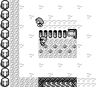
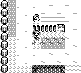

# 玩家迈步时的 NPC 待机分支

普通游走 NPC 原先可在玩家一格尚未走完时发起新的随机移动。现在待机 NPC 等待玩家的 `walk_counter` 归零；已经进行的 NPC 行走、延迟倒计时和脚本路径继续执行。实现复用现有暂停随机决策机制，保留可见性、占位和更新后的原始移动类型。

原作 [UpdateNPCSprite](https://github.com/pret/pokered/blob/fbcf7d0e19a3a2db505440d3ccd3d40ca996c15c/engine/overworld/movement.asm) 先处理行走与延迟分支，待机分支随后读取 `wWalkCounter` 并在非零时返回。修复只补齐这一条件。

## 正常启动前后对照

同一份离线编辑的原作格式 32 KiB SRAM，正常启动选择 CONTINUE，位于真新镇 `(5,10)`。固定 seed42，静止64帧后，按32帧左/右交替，共119帧，再释放按键128帧。仅使用物理按键、中性帧和只读观察，没有运行时设置、传送、快照加载或恢复。

- 基线 `13ed99a10d1dc0434e9a8f165a8a6d53c4a4e0a3`，修复代码 `e37573f8dfc034e52e52d1be273126ad10c6e162`。
- 两版各248次观察，完整按键、观察帧号和玩家状态一致；录制期间源码、HEAD、可执行文件、输入存档均保持不变。
- 基线在790→791帧中，玩家连续两帧位于同一格并处于 Walking，无脚本或对话，NPC1 的行走计数从0变16，朝向从右变左。
- 修复版没有这次提前启动；玩家停步后，NPC仍正常恢复更新。
- 核心用例直接检查玩家计数7、6与0的边界，并覆盖已有行走、延迟归零和屏幕外脚本路径。

下图是未裁剪、未编辑的完整帧807。玩家位置和动作相同，NPC的位置差异来自此前提前启动的移动。帧791虽然只读状态已不同，显示图像尚未不同，因此未将它用作画面差异证据。

| 前 | 后 |
| --- | --- |
|  |  |

证据范围是本项功能的实际前后行为，不包含原作逐周期、光栅或音频一致性证明。`Game.close` 在断言后主动 SIGTERM 终止无窗口进程；成功驱动退出码为0。

## 测试与重放

核心包及集成测试3606项通过，另有一个文档示例忽略；应用库386项通过、38项忽略。新增5项针对性测试，修复前正确复现2项失败，修复后全部通过。

`base-native.json.gz` 和 `fixed-native.json.gz` 保存按键、只读观察和冻结检查；`comparison.json` 汇总对照；`manifest.json` 保存文件和来源哈希。

复制驱动、存档和启动按键到忽略目录，然后在两个源码版本分别构建同一个共享 target 的游戏文件。无需保留游戏可执行文件副本：

```bash
: "${CARGO_TARGET_DIR:?请设置为现有共享 target}"
HARNESS_DIR=$(mktemp -d "$PWD/.task-tmp/npc-ready-replay.XXXXXX")
cp docs/audits/npc-ready-player-step/{replay.py,fixture.sav,boot-commands.json} "$HARNESS_DIR/"
git switch --detach 13ed99a10d1dc0434e9a8f165a8a6d53c4a4e0a3
CARGO_INCREMENTAL=0 cargo build --locked -p pokered-app --bin pokered-app --features debug-server
python3 "$HARNESS_DIR/replay.py" --repo "$PWD" --binary "$CARGO_TARGET_DIR/debug/pokered-app" --out "$HARNESS_DIR/before"
git switch --detach e37573f8dfc034e52e52d1be273126ad10c6e162
CARGO_INCREMENTAL=0 cargo build --locked -p pokered-app --bin pokered-app --features debug-server
python3 "$HARNESS_DIR/replay.py" --repo "$PWD" --binary "$CARGO_TARGET_DIR/debug/pokered-app" --out "$HARNESS_DIR/after" --expect-pause
```

驱动要求工作区干净且输出目录尚不存在。证据驱动使用 TCP 读取加速器，公开驱动使用普通 `DebugClient`；`--speed 0` 下游戏只随显式帧指令推进。
