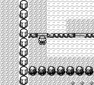
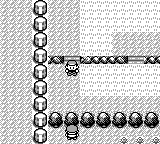

# NPC 可更新范围与移动

玩家在远处停留时，游走 NPC 原先仍会移动、转向并推进计数；走近后，其位置已经偏离原作。现在移动与图像生产共用原作的坐标范围检查。范围外的普通 NPC 暂停更新，脚本路径保留越界移动能力，地图对象的显示开关和槽位顺序保持原值。

原作 `UpdateNPCSprite` 先调用 `CheckSpriteAvailability`，不可用时直接返回，随后才处理延迟、行走和待机。判断使用含四格边缘的原始字节坐标；脚本移动跳过坐标矩形检查。对照来源为 [pret/pokered 固定版本的 movement.asm](https://github.com/pret/pokered/blob/fbcf7d0e19a3a2db505440d3ccd3d40ca996c15c/engine/overworld/movement.asm)，源码 SHA-256 收录于 manifest。

## 实际游戏证据

使用同一份离线编辑的原作格式 32 KiB SRAM，普通启动并选择 CONTINUE，进入 1 号道路 `(5,19)`。两版随后使用相同按键：静止观察 128 帧，按下 16 帧、松开 16 帧到 `(5,20)`，再静止观察 96 帧。所有推进均为物理按键或中性帧，观察接口只读。未使用运行时设置、传送、快照加载或恢复。

- 基线：`2ae12ed68780eedbfa6fe72e74d09fc30b65091c`。
- 修复代码：`0ca514fcf0f38c1d892321ac8c376f575de4cc2d`；后续证据提交只增加文档。
- 进入观察窗口时，基线的两个屏幕外 NPC 已从 `(5,24)`、`(15,13)` 移至 `(5,25)`、`(16,13)`。随后 128 帧中有 19 次只读观察发生变化。
- 修复版保持两个 NPC 的初始位置、朝向和行走计数，128 帧中变化次数为零；靠近后的 NPC0 恢复朝向更新，远处 NPC1 保持暂停。
- 另一次修复版录制延长附近观察，并再向下走一格到 `(5,21)`：900 次观察中，NPC0 行走计数达到 16，最后完成移动到 `(5,25)`；NPC1 全程保持原值。
- 两版观察帧号和玩家状态一致；完整按键记录除截图输出目录外一致。每次录制均确认源码、HEAD、可执行文件和输入 SRAM 保持不变。

`get_npcs.visible` 表示地图对象的显示开关。可更新范围按坐标矩形计算。该只读接口公开位置、朝向及 `walk_counter`；`delay_counter` 的暂停由核心测试验证。

以下为未裁剪、未编辑的同一帧 864，玩家均位于 `(5,20)`。基线 NPC0 朝下且正在行走，修复版 NPC0 朝上待机；此前屏幕外更新带来的状态差异在靠近后可见。

| 前 | 后 |
| --- | --- |
|  |  |

这里只证明这项功能的实际前后行为，未宣称与原作逐周期、光栅或音频一致，也未宣称新游戏通关验证。录制断言完成后，驱动通过 `Game.close` 主动终止无窗口进程，进程的 `-15` 为预期 SIGTERM；成功驱动退出码为 0。

## 文件与回归

`base-native.json.gz`、`fixed-native.json.gz`、`fixed-extended.json.gz` 保留按键、逐帧只读观察和冻结检查结果；`comparison.json`、`extended-summary.json` 汇总断言；`fixture.sav` 为复现存档，`fixture-provenance.json` 列出离线坐标编辑和校验和；`manifest.json` 保存来源与文件哈希。

本地 `cargo test --offline -p pokered-core` 共 3601 项通过，另有一个文档示例忽略；应用库 386 项通过、38 项忽略。新增测试覆盖屏幕外暂停及接近后恢复、行走时目标坐标处于范围两侧、脚本越界移动和隐藏对象保持隐藏。旧移动、方向限制及叫声测试把玩家放入范围后再验证原有行为，并增加实际活动断言，避免暂停后空通过。

## 重放

复用现有 Cargo target。先把驱动、SRAM 和启动按键复制到仓库外或忽略目录，再切换基线；无需保留两份游戏可执行文件。示例从修复分支执行：

```bash
: "${CARGO_TARGET_DIR:?请设置为已有的共享 target}"
HARNESS_DIR=$(mktemp -d "$PWD/.task-tmp/npc-availability-replay.XXXXXX")
cp docs/audits/offscreen-npc-availability/{replay.py,fixture.sav,boot-commands.json} "$HARNESS_DIR/"

git switch --detach 2ae12ed68780eedbfa6fe72e74d09fc30b65091c
CARGO_INCREMENTAL=0 cargo build --locked -p pokered-app --bin pokered-app --features debug-server
python3 "$HARNESS_DIR/replay.py" --repo "$PWD" \
  --binary "$CARGO_TARGET_DIR/debug/pokered-app" --out "$HARNESS_DIR/before"

git switch fix/offscreen-npc-updates
CARGO_INCREMENTAL=0 cargo build --locked -p pokered-app --bin pokered-app --features debug-server
python3 "$HARNESS_DIR/replay.py" --repo "$PWD" \
  --binary "$CARGO_TARGET_DIR/debug/pokered-app" --out "$HARNESS_DIR/after" --expect-freeze
python3 "$HARNESS_DIR/replay.py" --repo "$PWD" \
  --binary "$CARGO_TARGET_DIR/debug/pokered-app" --out "$HARNESS_DIR/extended" --expect-freeze --extended
```

驱动要求工作区干净，输出目录尚不存在。证据录制使用了 TCP 读取加速器；公开驱动使用普通 `DebugClient`。在 `--speed 0` 下，两者只影响墙钟耗时，按键和游戏帧推进相同。
