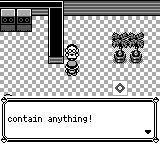
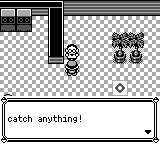

# 西尔佛公司 5F 科学家战后台词

科学家被击败后再次交谈，英文结尾应为原作的 `catch anything!`，此前为 `contain anything!`。仅恢复这一处英文措辞。

原作依据：pret/pokered `fbcf7d0e19a3a2db505440d3ccd3d40ca996c15c` 的 `scripts/SilphCo5F.asm`，训练家头部 `SilphCo5TrainerHeader1` 把 `EVENT_BEAT_SILPH_CO_5F_TRAINER_1` 对应到 `SilphCo5FScientistAfterBattleText`；后者引用 `text/SilphCo5F.asm:_SilphCo5FScientistAfterBattleText`。原文结束语为 `catch anything!`。

原生 before 为 master `a2f1189ceb4074937222b9257267fd79348dff05`；修复生产内容为 `91a89b70`。使用同一份离线构造 SRAM，正常启动、CONTINUE，玩家位于 SilphCo5F `(8,4)`，以实体按键向上面对原有科学家 `(8,3)` 并交谈。录制期间仅允许只读命令、截图与逐帧按键，不使用 warp、运行时设值、skip_dialogue 或 restore。两边都在固定的按键/空等时间线下截图。

- 第 1123 帧第一页 PNG 完全相同。
- 第 1306 帧第二页分别为 `contain anything!` / `catch anything!`。
- 起始完整状态、对话结束后的完整状态一致，磁盘 SRAM 均未改变。
- 仓库内可移植重放脚本再次执行成功，修复后的两遍页面状态、PNG 哈希和起终点完整状态相同。
- 应用 debug-server 构建通过；西尔佛相关核心回归 18 通过、0 失败；检查确认只改一处英文短语，全部中文参数和剧情控制流保持一致。




`comparison.json` 保留源码/二进制/夹具身份。`before.json.gz`、`after.json.gz` 和 `portable-replay-result.json.gz` 保存实际命令、页面状态和截图哈希。`fixture-preparation.json` 列出相对模板的全部字节变化，`fixture.sav` 为重放夹具。可执行：

```sh
cargo build -p pokered-app --features debug-server --bin pokered-app
python3 docs/audits/silph5f-scientist/replay.py --output /absolute/path/to/new-output --binary target/debug/pokered-app
```

`--output` 必须尚不存在。旧版本重放可指定 `--expected-last-line 'contain anything!'`。脚本通过普通输入结束对话，断言最终位置及存档未变，然后关闭进程。

跨 master 的文本保留检查仅报告上述有意修正的 1 处英文差异；它不是一次零差异检查结果。独立核对确认所有中文参数保持原样。

验证边界：夹具预置已击败训练家旗标，不能据此宣称本次重新打赢了科学家或完成了正常旅行。原作措辞通过脚本和文本源验证，没有录制原作模拟器对话。准备阶段未正确转身及误选 Rocker 的尝试均被排除，没有计入此证据。

该处来自一次覆盖 3019 个非占位长文本行的启发式存在性扫描。存在于源码不等于运行时可达，扫描未覆盖短句、动态占位组合、分支执行和完整剧情顺序，因此不构成全部台词或全游戏无差异的结论。
