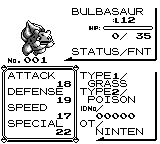
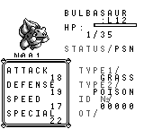

# Fainted status on the Stats page

The Stats page now checks current HP before choosing the stored ailment's
label. A Pokémon at HP 0 displays `FNT`, including when its saved status is
Poison. At positive HP, no ailment still displays `OK` and Poison displays
`PSN`. The correction changes the page's status binding; its layout is
unchanged.

## Original behavior

Reference source: `fbcf7d0e19a3a2db505440d3ccd3d40ca996c15c`.
Retail Red ROM SHA-1: `ea9bcae617fdf159b045185467ae58b2e4a48b9a`.
PyBoy version: 2.8.1.

`home/pokemon.asm:PrintStatusCondition` ORs both current-HP bytes before
examining the ailment byte. Zero HP prints `FNT` immediately.
`engine/pokemon/status_screen.asm:StatusScreen` replaces the result with
`OK` only when the status routine returns zero (alive, no ailment).

Four initial fixtures were explicitly constructed in a verified retail
Continue outdoor state before the saved-state/input boundary. Each party
has two Lv12 Bulbasaur with DV bytes `9a78`, cached stats
`[35,18,19,17,22]`, Tackle/Growl PP `[35,40,0,0]`, and zero StatExp. The first
has the HP/status combination below; the second stays healthy at HP35/35.
No RAM writes occur while the real START / POKEMON / party / STATS inputs
run. Each case runs twice and then uses ordinary SAVE/YES.

| Original case | HP | Ailment byte | Actual status text | Main SRAM checksum |
| --- | --- | --- | --- | --- |
| zero-none | 0 | 0 | FNT | 57 |
| zero-poison | 0 | 8 | FNT | 49 |
| one-none | 1 | 0 | OK | 56 |
| one-poison | 1 | 8 | PSN | 48 |

All eight Stats screenshots are at emulator frame 540. Repeats have
identical PNG bytes and action traces. The rendered status is independently
read from the original tilemap, and the screenshots were inspected. All
88 party bytes remain unchanged in RAM and ordinary SAVE SRAM, including
the healthy second member. All main SRAM checksums validate.
[Source manifest](source-verification.json) records construction, inputs,
ROM/state/image/SRAM hashes and results.

## Native comparison

The reusable [base fixture](native-base-fixture.json) has the same two-party
HP/stats/moves/DV gameplay construction. `one-*` cases change only the
first member's HP to 1; `*-poison` cases change only its status to Poison.
The modern snapshot is loaded before the input window. Each run copies the
frozen binary into a private directory and starts without either an
executable-global or save-bound script-flags sidecar. Actual loaded flags
are recorded and match across every case, build and repeat.

The before binary was frozen from master `117a326a`; the production diff
from that revision to this branch's base `959b3e38` is empty. The after
binary was built from corrected production `36bb0232` and test revision
`f14cb856`, with `--features debug-server`.

The PR subsequently integrates master `3568cac4` (the independent PP Up
refusal/reselection fix). That merge does not change Stats rendering or
these HP/status fixtures; the captures above remain evidence from the
recorded revisions, rather than a claim that every production file in the
updated branch matches the capture base.

The fixed real START / POKEMON / party / STATS trace captures frame 428
for every case, build and repeat (16 complete runs). The capture script
uses read-only `get_flags` observations as well as fixed frame inputs;
the manifest includes the full trace. Every run returns through the menus
and completes ordinary SAVE/YES. Independent SRAM import preserves the
HP, status, stats, StatExp, moves, PP, healthy second member, cash 3,000 and
bag contents. The full native party bytes also match across builds.

| Native case | Before | After |
| --- | --- | --- |
| HP0, no ailment | STATUS/OK | STATUS/FNT |
| HP0, Poison | STATUS/PSN | STATUS/FNT |
| HP1, no ailment | STATUS/OK | STATUS/OK |
| HP1, Poison | STATUS/PSN | STATUS/PSN |

Both repeat PNGs are identical within each build/case. Alive control PNGs
are identical across builds. For each fainted case the pixel differences
are confined to the status-value rectangle. Original images are separate
reference evidence and do not replace these matched native captures.
[Native manifest](native-verification.json) records binary/fixture/image/
SRAM hashes, flags, repeat checks and the pixel-difference bounds.

前 / 后, each pair at native frame 428:

Alive controls:

## Regression coverage and limits

The live Stats draw tests cover HP0 taking priority over every ailment,
HP1 distinguishing OK/PSN, and legal HP256 preserving all positive-HP
labels. The last case protects the original two-byte HP guard; its fixture
is a Lv100 Chansey whose max HP exceeds 256. Drawing also must preserve HP
and ailment. The three selected tests and all 112 UI tests pass with
`--no-default-features --features framebuffer,pokered-renderer/resource`.
The default desktop app with `debug-server` builds successfully.

This is status-selection and stable-frame evidence, not an assertion of
full rendered animation cadence or whole-save parity with the original.
The original's catch-rate byte and native save metadata are outside this
UI correction.

Private evidence is located through
`.task-tmp/fidelity-39-plus/audit-845-original-status-path.txt` and
`audit-845-native-status-path.txt`. Scripts are
`audit-845-original-status.py` and `audit-845-native-status.py`; logs are
`audit-845-original-status.log`, `audit-845-native-status-before-repeat.log`,
`audit-845-native-status-after-repeat.log`, `audit-845-final-stats-status-tests.log`,
`audit-845-final-ui-tests.log` and `audit-845-debug-app-build.log`.
An initial native frame expectation of 408 omitted observation-driven
frames; that run was rejected. The first app build omitted `debug-server`
and could not connect, so that run was also rejected before menu
validation. Both failure records are retained separately and excluded from
the 16 successful runs. A framebuffer-only test build initially omitted
the existing renderer's required `resource` feature; the explicit feature
union above compiled and passed without changing renderer source.
