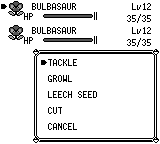
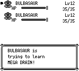
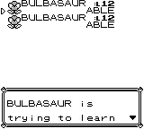

# TM/HM full-move learning — audit 870

复刻满4招式时直接打开忘记招式列表，缺少原作的 Trying/Delete/Abandon 提示；拒绝删除 HM 后光标留在 HM 上；TM 在结果文字确认前已经消耗。现在复用 Rare Candy 的 field LearnMove 状态机：

- 保留既有 BootedUpMachine、Teach YES/NO、party selection。
- 满4招式先 Trying → 4 moves warning → Delete YES/NO → forget list。
- Delete NO/B 或忘记列表 B/CANCEL → Abandon YES/NO。YES 印 DidNotLearn、返回背包，消费0；NO 重新 Trying。
- 拒绝删除 HM 后保留待学招式，光标复位0，可重选。
- 成功时先 Forgot/And，再写招式与PP，再 Learned + GetItem1 音效；消息/音效完成、玩家确认之后 TM 只消费1，HM始终不消费。空招式位同样在 Learned 确认后消费。

机器不提高等级、重算成长值、不画 Rare Candy stats box，也不触发进化。保留机器 party mode 与选中成员，兼容既有选择提示。Candy 的 stats → moves → evolution → consume 政策不变。两类使用同一个 continuation，也共用 restore/soft-reset cleanup；未复制第二套学习状态机。内部 `rare_candy.rs`/Flow 命名保留以缩小改动。

## 原作依据与实际范围

原作 `engine/items/item_effects.asm:2154–2249 ItemUseTMHM`：Boot/Teach/CanLearn/Known 检查后调用 LearnMove，等返回的成功标志 `b`，成功 TM 才 RemoveUsedItem，HM直接返回。`engine/pokemon/learn_move.asm`：TryingToLearn/AbandonLearning/DontAbandonLearning/PrintLearnedMove，`.hm → .loop` 每次重新初始化光标0；PrintLearnedMove 的文字与音效返回在机器消费之前。

audit860 已通过原作实际菜单10次（五流程×2）与普通 SAVE；这些旧原作证据保留其原有版本，不叫870新原作录制。原作 source `fbcf7d0e19a3a2db505440d3ccd3d40ca996c15c`、零售 ROM SHA1 `ea9bcae617fdf159b045185467ae58b2e4a48b9a`、PyBoy2.8.1。场外 save/state 构造两名合法 Bulbasaur、相同 DV `9a78`/ID/等级/缓存 stats/EXP、健康第二只；从 `constructed-start.state` 开始只按键与只读执行 hook，未动态修改状态或直接调用 LearnMove。机器/满招式构造与正常 SAVE 字节在 verification 记录中。

TM21/MegaDrain 用 Bulbasaur12、HP35、Tackle/Growl/LeechSeed/Cut、PP35/40/10/30；TM21×2。HM01/Cut 用合法 Bulbasaur13、HP37、Tackle/Growl/LeechSeed/VineWhip、PP35/40/10/10；HM01×1。初始PP Ups0、现金3000。没有战斗/升级/进化。复刻只启动前准备 JSON，private binary/cwd/SAVE/sidecar，之后正常 START→ITEM→USE→Boot→Teach→选中成员→学习→普通 START→SAVE，再 import-snapshot/SRAM 读回。

| 流程（各×2） | 原作、before、after最终招式/机器数量 | 修复前缺陷 | 修复后实际行为 |
| --- | --- | --- | --- |
| TM 替换 Growl | MegaDrain，TM×1 | 直接忘记列表、提前消费 | 完整提示；Learned仍×2，ACK后×1 |
| Delete NO + Abandon YES | 原招式，TM×2 | 无 NO 问题；只能用列表CANCEL代替 | DeleteNO→AbandonYES→DidNotLearn |
| 忘记列表 B + Abandon YES | 原招式，TM×2 | 直接回party | AbandonYES→DidNotLearn |
| 拒绝删除 Cut、重选 Growl | Cut保留、MegaDrain，TM×1 | HM retry cursor3 | 同一待学招式、cursor0 |
| HM 替换 Growl | Cut，HM×1 | 提示流程缺失 | 完整提示，HM始终×1 |

原作、冻结 parent BEFORE 与修复 AFTER，各10次真实普通 SAVE。三个版本的两名成员共88个 party SRAM bytes在所有流程逐字节一致，包含 catch-rate byte7/51，无字节排除；成功新招式PP10/30，其他PP/PP Ups、HP/maxHP、缓存stats、成长值、EXP、健康第二只、金额3000均保持。所有checksum有效。

本次修复对最终学习效果没有补丁式差值，它恢复玩家看见和操作的流程及消费时点。before的 tm-decline 仍明确是“原作 DeleteNO 路径不存在，用列表CANCEL代替”的历史缺陷证据；没有把这个替代动作说成按到了原作 NO。after遵循原作的逻辑选择。前后只在最初相同输入前缀完全一致，恢复的新问题会使后续按键数量/帧不同。

真实数量边界以只读 `get_agent_state level3` 检查，每次query前后frame_count相同。after TM-replace 在 Learned frame928 数量2，中立200frames至1128仍2，A确认1164后1；HM-refusal同样2→2→1；HM1→1→1。原作 TM-replace 的 Learned2212仍2、返回2456后1。原作和复刻不是绝对帧对齐。native before 的真正 learned-message 单独捕获（frame892/1108），不是将 combined forgot 文本标成学会消息。

## 截图与版本身份

同一 fixture、同一输入前缀、同一 native frame472：

前（parent 901）：

后（child a548）：

原作参考，独立模拟器语义阶段，不代替 native before/after：

其他 after 真正菜单帧保留 Delete/Abandon/DidNotLearn/HMretry/Learned PNG，具体帧数见 verification。BEFORE `audit-850-perf-final-debug` SHA `90110dbe6967526901a2802beba0e8459f24ff280a854b5dc9ef454829f08177`，编译的Git parent1566+已测试Oakpatch，其完整manifest的584个crate Rust源逐一匹配最终提交d455。没有改称clean2cc、当前master或新2cc构建。parent2cc另合入236的HP0门禁修复/测试，健康审计路径没有变化。

AFTER 是 clean `a5488a64c8f5641e80105d6b884e5fbc67296eff`（基于parent2cc），debug-server/dev opt2/debug0，SHA `f726a5e287ec6c78df3f78e5855d6b23b498653ac47642cf0d5a8284ddba60c2`。父PR238尚未合入时，这份子修复不发布；父合入后必须更新master base并完成必要当前base比较图。此处不将冻结旧图重标成更晚构建。

## 校验与资料

10个本次应用测试通过：TM/HM full/free-slot、成功ACK/消费、NO/B/listCANCEL/Abandon retry、HM cursor0、保留PP Ups/Stats/伙伴、无stats-box/evo、Boot/Teach/partyCancel/Known/Incompatible、FNT full-set、bench target、restore以及真实soft-reset→CONTINUE。11个父 Rare Candy 兼容回归通过。debug-server app构建通过。

全debug-app结果 **258 passed / 1 failed / 38 ignored**；失败是已独立确认的既有 `gift_dialogue_debug_tests::skip_dialogue_stops_at_gift_question_without_selecting_yes`（GiftQuestion→nickname prompt）。原始失败日志保留，并没有将整套应用测试称为通过。父Gift边界独立审计中，本修复未修改gift逻辑。

[verification.json](verification.json) 包含每次run目录、构建/脚本/fixture/SRAM哈希、checksum、原作关键执行事件、原作菜单帧、before/after对应菜单帧、只读数量检查点和最终字节结果。完整原始source事件/旗标读取在各run的record.json保留。少量重复旧870v1 scope文字/combined-forgot命名错误已由明确版本身份和真实learned-message的v2全10次重跑纠正；旧尝试不作为最终报告源。

[fixture-template.json](fixture-template.json)、[replay-native.py](replay-native.py) 可按启动前构造派生五种流程；参数 `before|after FROZEN_BINARY SOURCE_IDENTITY`。脚本仅使用普通按键、只读GetState/get_flags/get_agent_state/capture_frame，普通SAVE并读回；本机maps路径与构建运行库按 `scripts/debug_drive.py` 约定。[replay-original-audit.py](replay-original-audit.py) 原文复制原作审计脚本，需要记录中的本地零售ROM、symbols/PyBoy bootstrap/base state，ROM/state不提交。

实际源流程覆盖如表。Abandon NO retry、额外native列表CANCEL、free-slot、FNT full-set、bench-target、restore/reset有针对性应用回归，未新增这些分支的原作现场录制。不宣称字体、对话框布局、全部菜单绝对时序或整个world SRAM一致。
