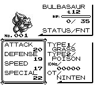
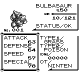

# Vitamin item behavior

Vitamins now follow the original field item rules: fainted Pokémon can gain
StatExp, a use below 25,600 adds the full 2,560 even if the result passes that
threshold, and recalculating stats preserves current HP. The correction is
local to `use_vitamin`; other stat recalculation callers keep their behavior.

## Original menu and SAVE evidence

Reference source `fbcf7d0e19a3a2db505440d3ccd3d40ca996c15c`, unmodified retail
Red ROM SHA-1 `ea9bcae617fdf159b045185467ae58b2e4a48b9a`, PyBoy 2.8.1.
The verified Continue outdoor state was used to construct each initial party
before the input window: two Bulbasaur with DV bytes `9a78`, first
fainted/injured/near-threshold as below, second healthy Lv12 HP35/35. The bag
contains two copies of the selected vitamin and cash is 3,000. Every item use
then follows actual START, ITEM, USE and party-selection buttons, with no RAM
writes in the input window and no routine-entry bootstrap.

| Original case | Current HP | Saved StatExp | Cached stat | Bag after |
| --- | --- | --- | --- | --- |
| Protein, fainted Lv12 | 0 → 0 | Attack 0 → 2,560 | Attack 18 → 20 | 2 → 1 |
| HP UP, injured Lv50 | 10 → 10 | HP 0 → 2,560 | Max HP 115 → 121 | 2 → 1 |
| Protein, Lv50 near threshold | 10 → 10 | Attack 25,500 → 28,060 | Attack 83 → 84 | 2 → 1 |

Each case then performs ordinary SAVE/YES. Independent source-derived SRAM
reads match the complete 44-byte party record, StatExp, HP, stats, PP, bag and
cash. Main checksums validate at 241, 35 and 19 respectively. Existing move PP
stays `[35,40,0,0]`, cash stays 3,000 and the healthy partner is byte-identical.
[Compact verification](source-verification.json) includes state, SRAM,
script and screenshot hashes.

The original code in `engine/items/item_effects.asm` selects `.useVitamin`
before any healing HP check. It rejects only a StatExp high byte of at least
100, then adds ten to that byte. `.recalculateStats` writes the cached stats;
it does not perform the HP delta adjustment used by the adjacent Rare Candy
routine. That separate item's behavior is outside this correction.

The original status screens below were inspected. They are additional source
reference evidence; they do not substitute for matched native master/branch
before-and-after captures.

## Native validation

Core regressions cover the original fainted Protein and injured HP UP results,
full gain crossing the eligibility threshold for all five vitamins, rejection
of a second use above the threshold, and the bag dispatcher selecting a
consuming result with preserved HP, moves, PP and total experience.
`cargo test -p pokered-core vitamin` passes 20 selected tests. The full
`cargo test -p pokered-core` suite passes 3,262 tests (2,850 library and 412
integration), with no failures; one documentation example is ignored. Logs
are `audit-841-vitamin-tests.log` and `audit-841-core.log` in the private audit
directory. `git diff --check` passes.

Native full-menu captures and SAVE readback on the corrected build remain
pending at the initial core commit. Full rendered cadence parity is not
claimed by this item-rule verification.

Full original inputs, routine observations, ordinary SAVE and stats-menu
captures remain at the directory named by
`.task-tmp/fidelity-39-plus/audit-841-original-vitamins-path.txt`. The three
private capture scripts are `audit-841-original-vitamins.py`,
`audit-841-original-vitamins-save.py` and
`audit-841-original-vitamins-view-stats.py`.
