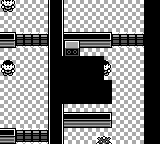
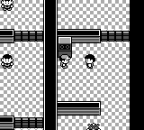
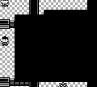
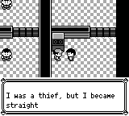

# 红莲道馆答错后的训练师走位

原作 `CinnabarGymDefaultScript` 会让玩家转身，安排对应训练师走近，等走位结束后显示其正常战前对白，再开战。本修复为六台问答机补齐这段顺序；第二名训练师的路线是先左再上，其余五名向左走一格。已击败训练师时，答错只结束问答。

## 验证

- 两项 core 测试通过：96 组语言、门状态、训练师状态和答案组合；18 个非朝上互动；六条真实 NPC 路线。路线测试完成问答前缀后，由实际 overworld 更新推进走路计数、对白及战斗交接。
- 三项现有 App 问答回归通过，覆盖五组冷启动存档和真实音效播放等待；debug-server CLI 构建通过。
- 实机对照的基线是 master `077034dbe197af52423eb02dc9dafbb8e7c0c76b`，修复源是 `c9743051e06ce73a933259f23daeb4c16726b185`。双方从同一份 32 KiB 存档启动，英文、seed 42、无音频输出；只使用正常按键和只读观察，无传送、强制战斗或帧填充。
- 固定输入共 2012 帧：`(A1,N7)×70 + N32 + Up2 + N4 + A2 + N4 + (B1,N31)×44`，其中 N 表示松开所有按键。该实机例覆盖第一台机器答错。
- 第 0–1085 帧的完整公开状态、NPC 和旗标一致。基线第 1087 帧进入战斗；修复后 NPC 第 1089 帧开始实际行走，第 1121 帧走完，第 1123 帧进入战前对白，第 1174 帧末页等待确认，再由固定 B 输入推进至第 1182 帧战斗。没有战胜输入，门和训练师旗标保持未设置，背包及存档保持不变。

下列截图直接来自同一输入向量的相同绝对帧。第 1100 帧展示走近过程；第 1160 帧展示战前文字逐字打印，基线已进入战斗转场。截图捕获前后的公开状态、NPC 和旗标完全一致。

### 第 1100 帧

### 第 1160 帧

战胜台词和开门音效的后续对齐单独处理。
