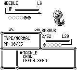
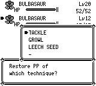
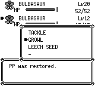
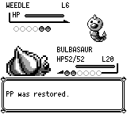
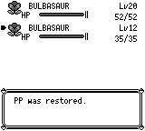
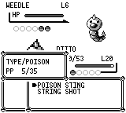
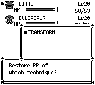

# 战斗 PP 恢复调用方：1030 补充证据

修复 Ether／Max Ether 的目标队伍招式选择与结果页、Elixir／Max Elixir 的队伍结果页，以及成功后最后一页 A/B 才消费一次道具的续接。Transform／Mimic 使用既有原身份恢复原招式 PP，再回抄四槽 packed PP；当前测试也覆盖 PP-Up、无效果／取消、快照和重置边界。

此次业务改动仍是十条 PP 源码／测试路径：core 的 `battle/mod.rs`、`state.rs`、`item_fidelity_tests.rs`、`pp_restore_caller_tests.rs`；app 的 `game.rs`、`battle_pp_restore_tests.rs`、`render/battle.rs`、`render/session.rs`、`render/battle_medicine_tests.rs`；UI 的 `menus/battle_move.rs`。不把尚未合入的 FIGHT 无 PP 提示、SELECT 交换或共享图像状态／时钟纳入此证据。

GBA 链接失败来自原 `repro-route22` 的 IWRAM 24568 B，超过原 24320 B 门限。依赖固定为 dotzuki `e533a3d`，仅使图块四颜色调色板映射共用 helper，标量像素／字形／矩形量化不变。同 feature 的实测 IWRAM 为 22636 B；六份实际 ELF 分别为 22624、22636、22640、22636、22636、22636 B。8192 B startup／IRQ 保留量和原性能门限均未调整。

本轮受测游戏源码为 `9624c7f8`、engine 为 `e533a3d2`：2175 编译输入、2693 项 docs 外 NUL Git 模式／blob／literal symlink、702 份素材及 engine 981 个 tracked 文件与 GBA mirror 均经前后校验。发布提交的源码等值证明见 `source-equivalence.json`，不把旧二进制、截图或普通 SAVE 改标为发布 head。

本地 28 阶段已全部真实结束：core 2944、renderer 400、debug app 334（39 忽略）、默认 app 323（37 忽略）、确定性 10；host／GBA metadata 分别解析 11／9 个同一 canonical engine revision 包。原六 feature 顺序及原门禁保持：性能 31 项、Route 22 的 40 次相遇、13 内存场景、23 逐帧场景、slow-cart hardware 6 场景、opening 3 场景。这里只证明本地 mGBA SDL 控制，不冒称官方 CI Qt 工件身份。

新截图前为实际 `26bd6050` master CLI，后为实际 `9624c7f8 / e533a3d2` CLI。三组固定预输入快照与 seed42，均从 skip-intro＋启动 warp 开始，逐帧记录完整按钮、同步 advance receipt 和 public state。每提供者 3568 帧，前后共 7136 帧，四对 PNG 的绝对帧分别为 Ether 688／1328、Elixir 1288、Transform 952。Transform 仅使用原 1584 按钮文件的前 952 帧，没有延伸到后续恢复结果或确认后的续段。所有 case 的私有 unused SAVE 路径保持不存在，子进程均终结；本轮不计普通 BOOT／Continue／SAVE 控制。

四对图的场景语义、按钮和帧相同，结果页上下文、物品待消费和原招式选择按本次修复有意不同，因此不要求跨版本完整 public state／RNG／SRAM 逐字相同。截图只作本 PP 调用方的可见对照，不宣称完整原作动画、IRQ、PCM 或像素布局一致。

| 同帧场景 | 前：26bd master | 后：9624 / e533 |
| --- | --- | --- |
| Ether 选择招式，688 |  |  |
| Ether 恢复结果，1328 |  |  |
| Elixir 恢复结果，1288 |  |  |
| Transform 后选择招式，952 |  |  |

证据文件：

- [evidence.zip](evidence.zip)：新控制器、固定输入、逐帧状态与八张实际 PNG。
- [manifest.json](manifest.json)：上述有限白名单和去重内容的校验清单。
- [gba-evidence.zip](gba-evidence.zip)：28 阶段日志与 GBA 原门禁的有限原始证据；不公开 ROM／ELF／可执行文件。
- [gba-manifest.json](gba-manifest.json)：GBA 证据包校验清单。
- [source-equivalence.json](source-equivalence.json)：发布提交与受测源码的逐文件等值证明。

[历史证据说明](../../audits/battle-pp-restore-caller/README.md) 保留原作14／原生前14／原生后14普通 SAVE，以及独立 Mimic Ether 路径等旧控制的原始身份与限制；本轮未重新采样这些 SAVE。

本地验证结果与正式 CI 分别记录。依赖实现固定为 `e533a3d2`，发布分支保留该提交；正式 CI 全部通过后合入。
