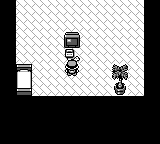
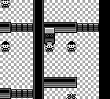
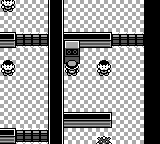

# 入图脚本：避免漏跑与重复执行

Continue 后，地图加载器已执行完首轮 `@load`，自动 OnEnter 又排入同一脚本，导致红莲道馆六门效果重复并吞掉紧随其后的输入。正常 New Game 则没有调用这段初始化，卧室初始朝向错误。

地图加载器现在统一直接调用 `@load`，不再额外注册自动 OnEnter。New Game 在名称、存档、队伍及语言上下文就绪后，通过同一入口执行一次；正常 warp、连接及重入各执行一次。`load_map_script_ex(false)` 只重建函数和触发器，不把脚本延迟到下一次 OnEnter；显式战后重跑仍保留。

旧快照只删除当前地图中 type、自动 ID 和 handler 都精确匹配的历史自动绑定，原 TriggerManager 的触发器顺序、已触发状态、前一地图/位置及其他 OneShot/OnceOnInteract 状态均保留。native 与 Boa 共用入口；另修正了该加载器在既存 Boa feature 下的非穷尽匹配编译问题。

本次对比实际主线 `762fc5a32602d7dcee4da23a687ad42a7751384d` 与运行候选 `60b1a191972f73e633d994200716a8c798658ef2`，使用各自实际构建的 CLI 和内嵌地图，无地图覆盖。这组截图保留实际 M1 / `60b1a19` 的运行身份。当前分支已普通整合后续主线 M2 `d6ebb68d5c4475ce65e46f06b669ac6b2efa27e3`，集成源码为 `bb9a63946dae8ef1e29e3a3722b80efdf0fc7950`。M2 唯一运行时增量是 common `ShowChoice` 确认音；两条原始路线全部 3970 条状态均无 choice/ShowChoice，且 Oak 菜单使用独立状态，因此不把历史截图重新标成 M2 实跑。

- 24 次定向测试执行通过（16 个不同测试名）：9 native、8 Boa、2 地图绑定、3 App 菜单/Continue 转换，以及 2 项主线红莲测验集成回归。候选 debug CLI 实际重新构建。
- 正常冷启动 New Game 使用同一份 1445 帧输入，正常经过 Oak 开场及默认命名，到达卧室 `(3,6)`：主线朝下，修复后朝上。双方独立 SAVE 路径及 sidecar 均不存在。
- Continue 使用同一物理 SRAM 和 525 帧输入：首轮六门结束后固定 neutral2、Up2、neutral12，修复后在红莲道馆 `(15,8)` 正常转向，主线重复效果吞掉输入。双方 SRAM 字节未变。
- 两组共 4 个 Game，26 张原尺寸同帧 PNG 逐对检查；源文件、engine、GFX、地图前后未变，全部进程组退出。未使用运行时 setter、warp、跳过对话或快照恢复。

正常 New Game，第 1445 帧：

Continue，第 525 帧：

Continue 的公开朝向状态在锚点后第 4 帧已改变，但早期 PNG 仍可能保留展示缓存；这里展示第 525 帧，不把状态变化时刻当成首个可见帧，也不声称原作逐硬件帧一致。

广泛回归仍有明确边界：历史 `fb6c886` 候选的全新 m01–m49 原 driver 运行只完成 m01–m11；m12 经原有两次黑屏恢复后第三次战败，最终以离开月见山的导航错误结束。原首败与全部记录保留，未重跑 fresh49。随后从同一战败后满血 Route4 持久状态，分别以历史 `077034d` / `fb6c886`、普通 Continue、seed42 和原 m12 策略做存档加速诊断，两侧均抵达华蓝市；两侧自适应路径与按键不同，不能据此排除 OnLoad 的因果影响，也不构成 fresh49 通过。

卧室脚本首次执行后永久变为 NOOP 的原作存档语义是另一项独立修复，本次不包含。

## 首次 CI 失败与定向修正

首次发布 `b515b50` 的官方运行保留：[App / Coverage](https://github.com/liuyanghejerry/open-pokered/actions/runs/38863100923) 因同两个测试 fixture 失败，[GBA 性能](https://github.com/liuyanghejerry/open-pokered/actions/runs/38863100924) 在移动窗口比较失败。GBA ROM 构建通过；性能失败之后的 10 个适用步骤未执行，未计为通过。

测试 fixture 在固定等待后只按 Start 一帧，可能落在原有两帧一次的 JoypadOverworld 采样间隙。现在用同一 InputState 连续按住两帧，第二帧清除 host 新按下边沿；原来的 60 帧等待、随后 4 帧等待和所有哭声、缓存/完整绘制断言保持不变。`77c5680` 实际运行两个原失败 App 测试、四项独立基准输入测试均通过，debug CLI 重新构建后与 `60b1a19` 的原生二进制字节相同。

从原脚本、位置及输入可推断，修复初始朝向后，基准在进入地图后继续连按 A 可能触发前方的 SNES 文本；原 CI 没有直接捕获该屏幕或对话状态。首次 CI 名为移动的 240 帧窗口实际重绘了 240 次。现在仅 `perf-benchmark` 在第一次进入真实 Overworld 后永久停止菜单 A 连按；其他诊断 ROM 的原控制器保留，原 Down 4100–4115、Right 4200–4215、测量窗口与阈值不变。

基准在计时区间外核验真实场景：第 4050 帧卧室 `(3,6)`，第 4290 帧 `(4,7)`，两处都必须是 Overworld、无文本/选项/脚本效果、脚本和移动空闲。终点来自同一张原作 BLK/BST 及通行表：两次输入各走一格；未设置位置或清除对话。

实际本地 GBA 源码为 `93925fe2ef9b49c240ffb9ce7c8b71942cb47344`（整合 M2 之前），mGBA 0.10.5 SDL 运行原 `gba_performance.py record/compare`。两锚点、七个固定采样数及全部 31 个原指标均通过默认 15% / 25 ticks 门槛；未改 baseline。

| 移动窗口指标 | 原基线 | 本地实际 | 原上限 |
| --- | ---: | ---: | ---: |
| draw / frame | 252 | 202 | 289.8 |
| draw max | 2707 | 2774 | 3113.1 |
| present / frame | 77 | 70 | 102.0 |

该窗口为 240 samples / 24 renders。ROM SHA-256 为 `70b7af9b51871734bfff3d76ea4ee29c9632796513999bc3ec80c6847c688865`；本地 SDL 结果保留自己的身份，不能替代官方 Qt CI 及其完整 GBA 检查。

两次本地 instrumentation 首败均保留：`77c5680` 的新锚点日志误用指标前缀，严格解析器拒绝；`636c94a` 把终点少算了 Down 一格，真实 `(4,7)` 触发断言。分别仅修正日志前缀和源推导的预期终点后，才执行上述 `93925fe` 单次完整比较；输入、测量区间和门槛始终未改。M2 集成后的源码闭环独立记录，未把这些旧运行重新标为集成 head 实跑。
