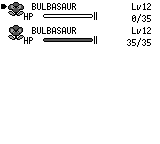
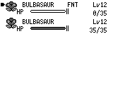
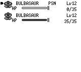

# 普通队伍菜单的 FNT 优先级

普通 START → POKéMON 菜单在 HP=0 时应显示 `FNT`，即使宝可梦仍保留中毒等异常。
原作 `engine/menus/party_menu.asm` 调用 `home/pokemon.asm::PrintStatusCondition`，
先检查 HP 的两个字节，只有 HP 非零才打印异常缩写。复刻此前仅检查异常：
HP0/None 留空、HP0/Poison 显示 PSN。现在按 HP 优先选择标签，并按实际可见标签
保留既有名字间隔；HP、异常、存档数据不变。

## 同输入截图

以下每组均为普通队伍菜单的第 256 帧，两个程序使用相同构造存档与按钮时间线。
基线 `e481388d`，修复程序 `ab616bb5`；英文、seed42、dev opt2/debug0。

HP0/None：




HP0/Poison：




## 复现与检查

[构造存档](fixtures/party-fainted-status.json) 可直接交给启用 `debug-server` 的程序：

```sh
pokered-app run --headless --debug-port 9000 --skip-intro \
  --snapshot docs/fixtures/party-fainted-status.json --lang en --seed 42 \
  --save /tmp/party-fainted-status.sav
```

等待启动后通过正常 START → POKéMON 打开列表。初始第一只 HP0/None、第二只健康；
将第一只 `status` 改为 `Poison` 得到另一昏倒案例，将其 `hp` 改为 35 得到存活中毒
控制。修改只在启动前构造存档中进行，验证时仅用真实按钮输入。

原作三种情况各两次，基线与修复程序也各六次：打开普通队伍列表、移动到第二只、
B 取消、通过正常 SAVE 保存。每次队伍 HP/status/招式/属性、背包、金钱和剧情 flags
均不变，SRAM checksum 有效；原作与复刻保存后的两只队伍共 88 原始字节完全一致。
同一程序重复的动作、截图和 SRAM hash 一致。存活中毒控制的菜单截图在修复前后
相同；只有两种昏倒案例的标签变化。这是构造场景检查，不是完整主线通关或整体
渲染对照。

限定绘制回归覆盖 HP0 的六类异常、HP1 与合法 HP256 的六类异常，以及长昵称在
FNT/PSN/无标签时的空间预留和非重叠。3 项新增检查及 UI 库完整 19 项通过。
