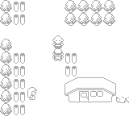
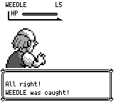

# 捕获结果首次发布与快照恢复：当前组合验证

在成功提示首次出现的更新中按 A，旧实现会同时发布并确认提示。捕获音效在核心更新之后才开始，此时已经进入战斗结束倒计时，能够在音效仍播放时提前返场。

修复让现有 `BattlePresentation` 页索引报告首次激活，首次更新只发布文字，后续确认由现有视觉和声音等待控制。快照只复制这个既有对象的 `enabled/page`；没有新的运行时所有者。`Some { page: None }` 精确保留未发布状态；缺字段的旧快照仅沿用当前页原有的一次确认行为，后续新页仍遵守发布边界。这一旧兼容路径不声称恢复未知发布状态或音效收据。

## 同物理按键、同实际帧截图

从 literal master 首轮普通 NO 教学记录提取完整 1,177 帧物理按键，包含初始 120 帧中立输入。两个冻结 binary 从同一 SaveData fixture 的实际 frame0 重放完全相同的 prefix，在共同实际 frame588、856、1145、1146、1177 抓取状态与图像。BEFORE frame1177 的 PNG 与原始普通输入记录逐字节相同。

下列两图都在**实际 frame1177**，没有按各自成功提示出现时间平移。BEFORE 已提前进入地图淡入，AFTER 仍在成功提示等待；两者的 logical CaughtMon SFX 都仍播放。

| | 源码 | 冻结 binary SHA256 |
|---|---|---|
| 前 | `a2fa94f185c08dfb568929a022b2ca66da0e0aa4`，literal master | `5a4831ccf960d1c00794ec8cd80b43dbc64a181748552b5b6dce6ebb6145f558` |
| 后 | `0fb1b57fd3096ba0332cd814319305fee1dc754b`，依赖组合修复 | `fd8cc0e06c5566945e1947e5cdef4db2e45d4a178be6c628f02d380151eabc25` |

前：

后：

## 本地检查与普通存档

| 冻结树 | full core | full app debug-server | full app default | agent_determinism |
|---|---:|---:|---:|---:|
| 905 `0fb1b57f` | 2930 | 329，39 ignored | 318，37 ignored | 10 |
| 920 `a07a7914` | 2934 | 329，39 ignored | 318，37 ignored | 10 |

原老人教学测试完整文件、原药品提示一次 B 确认断言保持不变。新测试覆盖普通／Safari × party／box 的首次发表帧 A、真实三声部及 PCM 非零和声音结束前不得进入 BattleOver；快照 JSON roundtrip 覆盖 page=None、待发表 current1、已发表 current1、core-only disabled，以及旧字段缺失后的当前页确认和未来新页屏障。

另从地图普通对话选择 NO 完成教学，健康／HP1 × 前／后 × 两次，共 **8 次普通 SAVE**。各次 party、box、bag、money、dex 受保护数据均未改变，HP1 保持 1。同组两次 SRAM SHA 完全相同。旧版四次都在成功提示后31帧、音效仍播时返场；修复四次都在实际音效结束后返场。本次自适应输入的首成功提示帧为前1146／后1143，独立记录，未用来对齐上面的同帧图。

CLI 控制只观察 logical SFX；三声部与真实 PCM 由实际 app 测试单独验证。publication DTO 不包含音频回放状态，queued moves/VFX 继续沿用原有重启契约。本记录不宣称完整原作帧数或 PCM 相位一致。更早的 905 截图和实测身份保留，未标成这次新 binary。

各 trial、完整输入 SHA、状态、图片、源码及检查日志 SHA 见 [verification.json](verification.json)。v1..v4 真实失败和 W943 原诊断均保留于本地 audit 归档，v5 没有覆盖它们。
