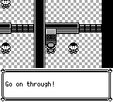
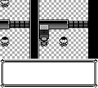
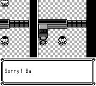
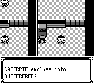

# 红莲道馆答题：内层文本、窗口及答案音效

六台机器现在按原作的内层 PrintText 调用顺序处理介绍、题目和答案。题目结束后直接进入 YES/NO，答对先画空白文本窗口、等待 GET_ITEM_1，再显示答案并接受一次确认；只有尚未开门时才播放 GO_INSIDE。答错会等当前声音结束，再播放并等待 DENIED，期间保留题面，然后显示错误文本。门标记和地图块在内层文本返回后更新，最后统一处理外层 A 释放及关窗。

文本内容、字体和排版没有修改。`printFieldText` 新增可选的 Button / Protected 提示模式及前导音效，默认仍是原有 DONE 行为；`finishFieldText` 显式结束当前保留窗口。Protected 模式保留原作三帧等待、采样边界及真实 PRESS_AB 音效，Button 模式不加这三帧。新增指令在 native、typed、Boa、DSL 和事件语义分析器中均有登记；生成图只增加六个门标记的保守 FlagRead 依赖，`requires` 不表示必须先开门才能答题。

## 原作调用依据

原作固定到 [`fbcf7d0e19a3a2db505440d3ccd3d40ca996c15c`](https://github.com/pret/pokered/tree/fbcf7d0e19a3a2db505440d3ccd3d40ca996c15c)。校对包括 wrapper 和 far payload，不能用 wrapper 的 `text_end` 推断实际提示终止符。

- [cinnabar_gym_quiz.asm:78–141](https://github.com/pret/pokered/blob/fbcf7d0e19a3a2db505440d3ccd3d40ca996c15c/engine/events/hidden_events/cinnabar_gym_quiz.asm#L78)：答对的 GET_ITEM_1、手动确认、仅首次开门声，以及答错 DENIED 两侧的等待。
- [text_2.asm:321–384](https://github.com/pret/pokered/blob/fbcf7d0e19a3a2db505440d3ccd3d40ca996c15c/data/text/text_2.asm#L321)：介绍和错误文本是 PROMPT，六道题是 DONE，正确答案 payload 后接外层 `text_promptbutton`。
- [window.asm:283–294](https://github.com/pret/pokered/blob/fbcf7d0e19a3a2db505440d3ccd3d40ca996c15c/home/window.asm#L283)：PrintText 先重画文本框、更新精灵、Delay3，随后执行内嵌声音。
- [text.asm:209](https://github.com/pret/pokered/blob/fbcf7d0e19a3a2db505440d3ccd3d40ca996c15c/home/text.asm#L209)、[text.asm:434](https://github.com/pret/pokered/blob/fbcf7d0e19a3a2db505440d3ccd3d40ca996c15c/home/text.asm#L434)、[joypad2.asm:55](https://github.com/pret/pokered/blob/fbcf7d0e19a3a2db505440d3ccd3d40ca996c15c/home/joypad2.asm#L55)：PROMPT 的 ProtectedDelay3、PROMPT_BUTTON 的直接确认及接受 A/B 后的 PRESS_AB。
- [text_script.asm:87–105](https://github.com/pret/pokered/blob/fbcf7d0e19a3a2db505440d3ccd3d40ca996c15c/home/text_script.asm#L87)：DoNotWait 跳过外层再次确认，仍保留 A 按住时的关窗等待。

## 实际前后对照

前为实际 master `89ef61e096387964897fed2c47f067b9b058097a` 编译的冻结 CLI，后为将它普通 merge 到答题分支后的 `476f064a7ae208c3f313bd4d4060a15851e5f58b`。两份 CLI 分别嵌入各自的实际地图源码，没有 scripts-dir 或环境变量覆盖。CLI SHA-256 分别为 `c8272e5655e3d3534224082cb8eab008890ce4a8b63c3bef6ad1359ac69534d3` / `c60175864f3022b47879c0ddb4a6b35acd43f196dd9a27731e83fc49e928b298`。

每组都从同一份物理预启动 SRAM 正常冷启动、CONTINUE，再以普通 UP / A / B 与前方机器交互；固定 seed 42，`--no-audio` 保留真实逻辑音频时序。两边每组各执行 2012 次 `press_timeline`，每次一帧、零 padding，并保存 0…2012 的完整公开状态。0…598 帧的角色、地图、队伍、金钱等前缀一致；604 帧均已在 CinnabarGym (15,8) 朝上进入第一次答题。截图命令不推进帧，也不改变输入。

| 首次答题事件 | 前 | 后 |
| --- | --- | --- |
| 锁门答对：选择菜单出现 | 959 | 995 |
| 锁门答对：GET_ITEM_1 活跃 | 此调用缺失 | 1026…1098，73 帧均为零字符空窗 |
| 锁门答对：GO_INSIDE 活跃 | 990…1009 | 1199…1218 |
| 锁门答对：门标记首次置位 | 1054 | 1219 |
| 答错：DENIED 活跃 | 990…1018 | 1023…1051，29 帧题面逐字保留 |
| 答错：首次交给战斗 | 1022 | 1087 |
| 已开门答对：首次答案音效 | 仍播放 GO_INSIDE | GET_ITEM_1 + 确认声，未播放 GO_INSIDE |

答对与已开门的长向量各包含三次交互，答错向量后半段已进入战斗。表格、声音区间和修复结论均限定第一次答题；后续周期及战斗按钮没有混入首次音效证据。

### 答对：同屏同帧 1036

两边均仍处于第一次答题。旧版已经显示末页答案；修复版正在播放实际 GET_ITEM_1，保留尚未印字的窗口。

前：

后：

### 答错：同屏同帧 1000

旧版已经显示错误文本；修复版此刻仍在题目选择菜单。这是相同固定输入时间线的比较，两边的流程阶段和声音时点不同。

前：

后：

修复版实际 DENIED 开始于 1023 帧，此时菜单已关闭，WaitSound 保留完整题面。下面只展示修复版的该帧；旧版已在 1022 帧切入战斗，不能称为两边同阶段或同声音时点。

## 验证范围与复现资料

| 实际提交 | 实际执行范围 |
| --- | --- |
| `361e506d`，历史私有依赖基线 | 全量 pokered-core：3412 通过（3000 unit + 412 integration），1 doc ignored；Boa API：14 通过 |
| `71c1a51e`，历史私有依赖基线 | App 三项、五种预启动场景及 CLI 构建通过 |
| `9676d241`，历史私有依赖基线 | pokered-agent --lib：55 通过，包括严格未知构造、生成图一致性和确定性 |
| `476f064a`，实际 master89ef 集成 | App 同三项、五种场景及 CLI 构建通过；本文三组实际 CLI 前后对照通过 |

历史 core / agent 测试没有改标为新的集成头执行。实际集成 App 测试从物理 SRAM 经正常 CONTINUE 和前格交互进入场景，通过真实静音 PCM owner 检查声音 ID、实际活跃声道及非零 PCM，覆盖锁门答对 A/B、答错 A/B、已开门 B，以及精确三帧提示、窗口持有、PRESS_AB 和外层 A 释放。

[provenance.json](cinnabar-quiz-audio-1055/provenance.json) 记录源码、CLI、控制器、所有输入、截图和原始日志 SHA-256，以及每组首次事件和首败记录身份。[first-cycle-sound-states.json](cinnabar-quiz-audio-1055/first-cycle-sound-states.json) 是原始公开状态中的 264 个首次目标音效活跃帧摘录。声音长度来自实际序列观测，没有把猜测时长写入逻辑，也不主张直接证明两条隐藏 RNG 流相同。

附件提供 [锁门 SRAM](cinnabar-quiz-audio-1055/locked-preboot.sav)、[已开门 SRAM](cinnabar-quiz-audio-1055/open-preboot.sav)、[A 向量](cinnabar-quiz-audio-1055/correct-buttons.json)、[B 向量](cinnabar-quiz-audio-1055/wrong-buttons.json) 和[本次实际控制器源码存档](cinnabar-quiz-audio-1055/recorded-controller.py)。SRAM 内容为 RED / BLUE、ID1234、道馆 (15,8)、满血 Bulbasaur30 / DV9a78、空背包、Fast 文本；仅已开门版本置位 GATE1，其余事件标记清零，无伴随 flags 文件。控制器源码保留当时的本地证据路径，是运行记录。

本次只处理内层文本、窗口与答案音效。共享 YES/NO 的选择音和 15 帧回绘、答错后的训练家走近及战前文字、CONTINUE 的重复 @load，仍在独立修复队列中。
