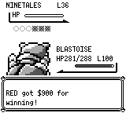
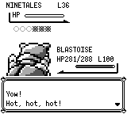
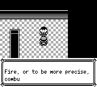
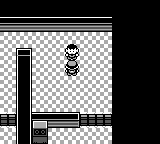
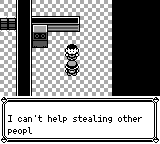
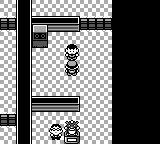
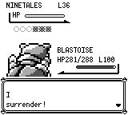

# 红莲普通训练家：胜利台词与开门声

红莲道馆七名普通训练家的胜利台词现在通过显式 `startBattleWithText(trainerId, quote)` 交给既有战斗管线，在奖金文字之前显示。七处直接对话和六处答错后挑战共 13 个场景调用均提供对应的原作 EndBattleText。胜利续接先等待当前声音，再播放并等待真实 GO_INSIDE，最后写入战胜、门标记和地图块；门先经答题打开、训练家尚未战败时也保留声音。非胜利不执行这些写入，胜利后不再自动播放 AfterBattleText，稍后再次交谈仍保留原有对白。

原有 `startBattle`、旧存档 effect 缺省值及劲敌特殊台词管线保持原有默认值。新增参数在 typed / native / Boa 注册链中显式传递，未按训练家类别猜测 NPC，也未新增一份待处理战斗状态；engine pin 不变。

## 原作依据

原作固定为 [`fbcf7d0e19a3a2db505440d3ccd3d40ca996c15c`](https://github.com/pret/pokered/tree/fbcf7d0e19a3a2db505440d3ccd3d40ca996c15c)。

- [CinnabarGym.asm:263](https://github.com/pret/pokered/blob/fbcf7d0e19a3a2db505440d3ccd3d40ca996c15c/scripts/CinnabarGym.asm#L263)：各训练家保存 EndBattleText 指针，已战胜后的再次交谈才选择 AfterBattleText。
- [battle/core.asm:915](https://github.com/pret/pokered/blob/fbcf7d0e19a3a2db505440d3ccd3d40ca996c15c/engine/battle/core.asm#L915)：先调用 PrintEndBattleText，再打印 MoneyForWinningText。
- [CinnabarGym.asm:97](https://github.com/pret/pokered/blob/fbcf7d0e19a3a2db505440d3ccd3d40ca996c15c/scripts/CinnabarGym.asm#L97)：非胜利退出；未战胜分支执行 WaitForSoundToFinish → GO_INSIDE → WaitForSoundToFinish，然后更新旗标和门块。是否已由答题开门不替代训练家的战胜判定。

## 实际执行身份

前为当时实际 master **M1 `762fc5a32602d7dcee4da23a687ad42a7751384d`** 的冻结 CLI，后为 **`912a593109c13495d04968e0b12436de6b910508`** 的冻结 CLI。二者分别嵌入自身真实地图源码，无 scripts-dir 或地图环境变量覆盖。CLI SHA-256 为 `c13fd2f3cba4cbf4878a7a3497a35af39b210becf0e006f03554d1bf8549911c` / `5318db30212aaea216aa05225cec043e4c11859ee5956a2d506bc14c473999fd`。

三组均从同一份有效物理预启动 SRAM 正常冷启动、CONTINUE、朝上交谈，再通过普通 FIGHT / SURF 赢得战斗。固定 seed 42、`--no-audio`，未在运行中设置旗标、位置、战斗、结果或 RNG，未恢复运行态 snapshot。向量在候选运行前由 M1 独立录制并冻结，追加预先声明的 `(B2,N30)×16 + N64`；候选状态不决定按钮。

| 场景 | 每边实际帧数 | 后：台词 → 奖金 | 后：GO_INSIDE 活跃 | 后：战胜 / 门标记 | 后：物理门块 |
| --- | ---: | --- | --- | --- | --- |
| trainer0，无物理门 | 3929 | 3130 → 3172 | 3220…3239 | 3240 / 3240 | 地图块保持不变 |
| trainer1，门关闭 | 3801 | 3034 → 3076 | 3124…3143 | 3144 / 3144 | 3145 才从 84 变 14 |
| trainer1，门已答题打开 | 3801 | 3034 → 3076 | 3124…3143 | 3144 / 原已置位 | 保持 14 |

基线三组均缺 EndBattleText 和胜利 GO_INSIDE。两边分别在 0…3129、0…3033、0…3033 的公开字段前缀一致，首次分叉为候选的原作台词与基线的奖金；对应字段名单在 provenance 中列明。后续阶段不要求相同，固定尾部结束时双方的队伍、金钱、位置、地图块、旗标等持久公开结果一致。

合计 23,062 次单帧 `press_timeline`，全部零 padding，保存 23,068 份逐帧状态。每次截图后再读取状态，与截图前缓存逐字相同，未推进帧。原始 5,292 张 PNG 和全 RPC 本地保留；本提交仅保存下面 8 张原始 160×144 PNG。所有原有 9 个控制器 / Game 进程组均已确认退出。

### 同帧对照

每行两边使用相同物理存档、按钮和帧号；Battle / Overworld 屏幕类型相同，脚本阶段可以因修复不同。

| 场景与帧 | 前 | 后 |
| --- | --- | --- |
| trainer0，3154：奖金 / 原作败北台词 |  |  |
| trainer0，3220：自动 After / 等待开门声 |  |  |
| trainer1 门关闭，3124：自动 After / 门仍关闭、开门声活跃 |  |  |
| trainer1 门已开，3058：奖金 / 原作败北台词 |  |  |

## 测试与源码等价范围

| 实际执行提交 | 实际通过范围 |
| --- | --- |
| `d96c92abaa2ea0ad82bf1a51c74178b0534f6879` | typed 参数专项 1 项 |
| `5ac8db7e5ad56bf7eb40f81ac79bdad968b12047` | 显式 `script-boa` 参数 / await 专项 1 项 |
| `912a593109c13495d04968e0b12436de6b910508` | core 红莲专项 16、旧 bridge 专项 1；全量 core 3427（3015 unit + 412 integration），0 失败、1 doc ignored；agent 56（含严格 coverage、unknown guard、生成图及确定性）；App 胜利 1 个测试 / 3 份冷 SRAM；原有答题 3 个测试 / 5 场景；debug CLI 构建 |
| 实际 M1 / `912a5931` CLI | 本文三组普通输入前后对照 |

App 胜利测试使用真实 Game、音频 sequencer、活跃声道和非零 PCM，检查台词先于奖金、等待期间物理门块与旗标未变、胜利后无残留，并再次交谈检查原有 AfterBattleText。Core 回归覆盖 13 个调用、已开门 / 无物理门、loss / draw 不写入、旧 API / serde 缺省及劲敌特殊台词不泄漏。原有 event graph 字节未改，严格 unknown guard 未放宽。

三组 Game 全终态之后才普通 merge M1，产生 `0a142ec43f1f1fe9252ed399192ded0064c1a4bf`，父提交精确为 `912a5931` 与 M1。预测及实际整棵 tree 都是 `1a563049ecee604dc51c71ee25c47899004d0d2e`，与实际验证的 `912a5931` 完全相同；源码、engine 981 文件、GFX 702 文件和原作 6 文件复核一致。文档附件提交不是新执行，历史测试和截图没有改标成合并头。

随后普通合入当前 master **M2 `d6ebb68d5c4475ce65e46f06b669ac6b2efa27e3`**，产生 `cd04a2cd80529847fa636029d054e5928dbcb74a`，无人工冲突处理。相对实际验证的 912，继承的生产改动仅为既有 field ShowChoice 分支内 4 行确认声，另有测试和文档；这时整棵树已不再与 912 相同。两条直接交谈 storyline 无 choice 调用，六份完整回放的 23,068 份状态均无 ShowChoice effect / 非空 choice，且 Game 战斗驱动未变，因此这项共享选择音改动不会进入所录路线。此为源码与记录闭环推断，不是 M2 整合头重跑；原 M1 / 912 截图和测试身份均保留。详见 [M2-integration.json](cinnabar-trainer-victory-1056/M2-integration.json)。

## 精简复现附件

[provenance.json](cinnabar-trainer-victory-1056/provenance.json) 保存三组实际边界、按钮 / 存档 / 截图 / 原始日志 SHA-256；[source-manifest.json](cinnabar-trainer-victory-1056/source-manifest.json) 记录实际 Git、CLI、源码树与 engine 身份；[validation.json](cinnabar-trainer-victory-1056/validation.json) 保存各阶段原始摘要和必要测试名；[recorded-controller.py](cinnabar-trainer-victory-1056/recorded-controller.py) 是本次实际执行源码存档，保留当时本地证据路径。

| 场景 | 物理存档 | 冻结按钮 |
| --- | --- | --- |
| trainer0，无物理门 | [SRAM](cinnabar-trainer-victory-1056/trainer0-locked-preboot.sav) | [3929 帧](cinnabar-trainer-victory-1056/trainer0-locked-buttons.json) |
| trainer1，门关闭 | [SRAM](cinnabar-trainer-victory-1056/trainer1-locked-preboot.sav) | [3801 帧](cinnabar-trainer-victory-1056/trainer1-locked-buttons.json) |
| trainer1，门已开 | [SRAM](cinnabar-trainer-victory-1056/trainer1-open-preboot.sav) | [3801 帧](cinnabar-trainer-victory-1056/trainer1-open-buttons.json) |

存档以纯 Rust export/import 构造并逐字段复核、重导出字节一致，包含 RED / BLUE、ID1234、道馆 (17,3) 或 (17,9)、满血 Blastoise100 / DV9a78 / Surf、空背包、3000 金钱、Fast 文本。仅 open 版本预置 GATE1，所有训练家战胜标记清零，无伴随 flags 文件。它们是公开的预启动测试 fixture，不是自然流程存档或隐藏 RNG 快照。

协议 frame0、单帧 A 导致 598 帧交互未开始，以及早期测试 / 归档读器首败均本地原样保留，身份见 provenance 的 `preserved_local_first_failures` 与 `old_test_first_failures`。本项没有执行或声明全平台 / 原作逐周期差分。
