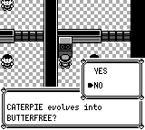
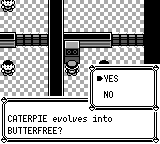

# 红莲道馆六台答题机的 YES/NO 输入

修复前，在默认 YES 上按一次上会跳到 NO；原作这条双选菜单不循环。这会改变回答结果。六台机器现在显式调用 `askFieldYesNo`，复用已有前台 Joypad 与文字流程，保留原题目、标签、正确答案及答对/答错后续剧情。

原作参考：`pret/pokered fbcf7d0e19a3a2db505440d3ccd3d40ca996c15c`：

- `engine/events/hidden_events/cinnabar_gym_quiz.asm`：内层题目 DONE 后直接进入 YesNoChoice；答对/错分支独立于菜单。
- `home/yes_no.asm`、`engine/menus/text_box.asm`：YES/NO 标签后清除 NO_TEXT_DELAY，B（包括 A+B）选第二项；接受后等 15 帧再恢复父画面并返回。
- `home/window.asm`：方向先处理 UP，再 DOWN；该普通路径 wrapping 未启用，边界停留。PlaceMenuCursor 后 Delay3，接受 A/B 时不重新绘制光标。
- `home/joypad2.asm`：普通 `hJoy7=0` 路径使用真实前台采样的 pressed，等待期间只更新 raw。

修复包含方向边界、同时按键优先级、菜单的三帧等待、确认后的十五帧等待、逻辑选项与已绘制箭头的区别，以及中间状态快照恢复。普通多项选择不由标签或选项数量推断这些规则。

## 独立复现

```bash
cargo build -p pokered-app --bin pokered-app --features desktop,debug-server
python3 docs/validation/cinnabar-yes-no-1092/replay.py \
  --binary target/debug/pokered-app --case after --output /path/to/new-output
```

`--case before` 用于修复前版本。两种 case 使用同一个 `quiz.sav`、seed42 和同一份 1,308 帧按键。目录必须不存在；可选 `--port`。文件哈希和最终断言见 `manifest.json`，运行结果见 `receipts.json`。

存档在 Game 启动前构造：玩家位于第一台机器前，门未开，训练家未击败，背包为空；通过普通冷启动 Continue、朝向/交互、逐页读题到达菜单。不使用运行中改状态、跳过开场、强制战斗/结果或调试保存。

第 1092 帧是默认 YES → UP → 四帧中性输入之后。额外稳定等待使两个版本都已完成菜单入场；修复版本还核对 UP 后实际进入 CursorDelay(3)，排除未采到按键的假通过。继续相同普通输入后，第 1308 帧修复版门已打开，修复前仍未开门。普通 SAVE 不是这个场景的验证范围，实体输入存档在运行后保持原样。

截图前图的 master 为 `e33d4af3199b9ef3e9b5823a2001ed0a6ca55509`；它是在捕获时的主分支。随后主分支合入独立的固定宝可梦遭遇修复，答题机的题目、通用菜单与相关渲染没有改变。

后图及集成验证源码：`af97cf205476d1ad0d188cc80fdfa16822806f2d`，已合入上述最新 master。Core 3119、Data/Boa 307、Agent 61、App 实际场景 4 项通过。

前：



后：



## 验证范围

Core 覆盖全部六题及 en/zh、两种答案、门/训练家既有状态的原始调用顺序；菜单测试覆盖上下边界、UP+DOWN、方向+A、A+B、忽略键、raw-only 等待，以及每个等待阶段的快照恢复。App 测试实际冷启动 SRAM 和普通输入，使用真实 sequencer/PCM 验证确认音只播放一次、答对 GetItem1、答错 Denied、开门音效和外层 A 松键。Agent 验证六个问题的门/训练家/路径效果仍被识别。

CLI 使用 `--no-audio`；本包不声称采集了原机逐帧或逐采样比较，也不将专项构造存档当作新游戏全程通关证据。
