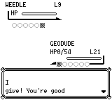
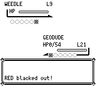
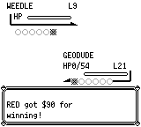
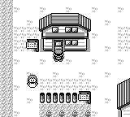
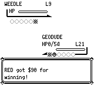

# 同时倒下：胜负与换人顺序

自爆或反伤让双方同时倒下时，先检查己方完整队伍。己方全部倒下应战败；有健康替补且敌方最后一只倒下仍可获胜。双方都有替补时先强制换出己方，再走敌方换人流程；保留原作 Trainer/Shift/队伍槽数条件下的可选换人提示，包括其余槽位已倒下的情况，避免重复结算倒下、经验或出招。

原作依据为 pret/pokered `fbcf7d0e19a3a2db505440d3ccd3d40ca996c15c` 的 `engine/battle/core.asm`：FaintEnemyPokemon 在己方全队无存活者时提前返回，RemoveFaintedPlayerMon 写战败结果；有替补时 ChooseNextMon 先于 ReplaceFaintedEnemyMon/EnemySendOut。具体定位、原文件哈希与源审见 `provenance.json`。

## 实际构建与输入

实际前版为 M4 `062e76d91fdbf5109fcc02793b8a8064788e8700`，后版为已普通合入 M5 的 `8c3c6b02ff1baf9887ba8b21bad2d958fd3ac4e7`。文档提交不作为重新执行的程序。前版没有重标为 M5：M4→M5 是聚宝功改动，其 `check_faint_after_turn`/`force_switch_player`、App、Renderer、Data 保持原字节；共享回合收据和结算代码确实变化。本场景不使用聚宝功，钱池为零，新增散钱/拾钱条件不进入，旧“奖金+0”与新纯奖金相同。这是源条件闭包，不声称 M5 前版实际重放、全部执行输入或时序全等。

两份 32768 字节物理 SRAM 在常磐森林 (2,19)，钱包 $1000；21 级小拳石 HP1/54，第四招自爆 PP5。对照额外携带健康的5级波波 HP20/20。普通继续游戏后向上转身并与 NPC4 捕虫少年交谈，对手为9级独角虫。两侧 seed42、speed0、英文、静音，同一3572帧普通输入，无运行中改状态、warp、快照或候选侧自适应。输入来自两次独立前版发现的相同2484帧，再接事先固定的1088帧尾段；候选执行前已经锁定。

| 场景 | 前：实际M4 | 后：实际8c3 |
| --- | --- | --- |
| 只有小拳石可战斗 | 错误胜利；$1090；训练师标记已击败；HP0；留在森林 | 战败；$500；训练师标记未击败；HP54/54、PP5；真新镇(5,6) |
| 有健康波波替补 | 胜利；$1090；训练师标记已击败；小拳石HP0、PP4；波波20/20 | 同前，保留合法胜利 |

两组均在1973帧显示使用自爆，同帧公开 `battle_live` 的双方HP均为0。HUD此时仍可能显示1/54，不用显示缓存推断存活。2229帧出现实际胜负分叉；仅小拳石的后版2336帧显示昏倒，2383帧抵达真新镇；前版2400帧仍发$90奖金。有替补两侧都在2400帧显示$90奖金。

## 同输入、同绝对帧画面

2336帧均仍在战斗屏幕：

2400帧的流程已经分叉，保留实际屏幕差异：

健康替补对照2400帧，两幅原图字节相同：

## 验证范围与复现材料

实际8c3完整 native core 3051项通过，debug-server CLI构建通过。两组原生配对各侧均完整重放3572帧一次；独立读取14292份状态、43356次RPC及对应回复、242张原图的尺寸/哈希/同帧状态，实际视检其中14张。源码/引擎/702个外部GFX、原始与复制SRAM前后未变，无sidecar。四个应用由控制器TERM后回收，实际应用退出-15；两个控制器工具退出0，全部六个进程组已消失。

双方仍有替补的强制换人、Shift/Set、dead-reserve提示和Link路径只有实际核心测试及原作源审证据；第三个双方有替补的原生场景仍待执行，不把本次两组原生结果扩成该覆盖。

保留的历史包括：最初a59的44项检查虽通过，独立源审发现其漏掉强制换出己方后的Shift提示；修正c687后重新跑44项，随后8c3另跑完整3051项。物理存档编码器首次因 `Party.len()` 编译失败，未产出存档或运行游戏；修正工具后才完成校验和/import/reexport字节恒等验证。所有原始失败身份、日志与修正收据在本地证据档案保留，SHA见 `provenance.json`，不覆盖或改标旧结果。

`only-geodude.sav`、`healthy-reserve.sav`、`fixed-buttons.json` 是实际输入；`recorded-controller.py` 是实际执行源码原字节。它要求真实两侧二进制、完整源码/引擎/GFX冻结、成功前版发现收据及固定输入计划；脚本不自带运行环境或二进制。复现须按实际本地路径与哈希建立计划，不能把旧绝对路径当作当前可用环境。源码身份、命令、输入与原始结果哈希、六幅图的帧号和出处见 `provenance.json`。
