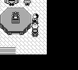
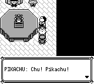

# 四处宠物：保留 inner PrintText 的叫声与确认顺序

宝可梦粉丝俱乐部的皮卡丘和小海狮、16 号道路飞翔之家大嘴雀、常青市昵称之家烈雀，旧版都要先确认并关闭文字窗才播放叫声。修正版全文显示完后自动播放一次叫声，在声音结束前保留同一窗口；随后等待外层确认、A 松开，再关闭窗口。

原作固定版本为 `fbcf7d0e19a3a2db505440d3ccd3d40ca996c15c`。这四个调用点分别见 [PokemonFanClub.asm](https://github.com/pret/pokered/blob/fbcf7d0e19a3a2db505440d3ccd3d40ca996c15c/scripts/PokemonFanClub.asm#L71)、[Route16FlyHouse.asm](https://github.com/pret/pokered/blob/fbcf7d0e19a3a2db505440d3ccd3d40ca996c15c/scripts/Route16FlyHouse.asm#L45)、[ViridianNicknameHouse.asm](https://github.com/pret/pokered/blob/fbcf7d0e19a3a2db505440d3ccd3d40ca996c15c/scripts/ViridianNicknameHouse.asm#L19)：`PrintText` 后接 `PlayCry`、`WaitForSoundToFinish` 和 `TextScriptEnd`。[PrintText](https://github.com/pret/pokered/blob/fbcf7d0e19a3a2db505440d3ccd3d40ca996c15c/home/window.asm#L283) 另有内层窗口准备；[外层显示](https://github.com/pret/pokered/blob/fbcf7d0e19a3a2db505440d3ccd3d40ca996c15c/home/text_script.asm#L87) 才负责最后的确认、A 松开与关闭。

新入口 `printTextCry(text, species)` 明确选择 inner PrintText 准备过程，并复用已有 FieldCry 声音等待和关闭流程。Far 入口的准备时序保持；缺少新 entry 字段的旧快照仍按 Far 恢复。四处现有双语文本、触发条件和其他 NPC 剧情保持原内容。

## 实际验证

在源码 `cce512062fab7ff17d60f033c552efed2ebb95fb` 执行 **14 次命名测试通过**：Core FieldCry 11、NativeHost 参数校验 1、Data 协议 1、Boa await 1。其中一个新增参数化测试通过真实嵌入地图脚本覆盖四处 NPC；已有 Far 调用、字速输入、声音中按键、A 松开、快照恢复及旧 entry 默认值也在该组中。这是组件/API 覆盖；四只宠物没有分别做正常 CLI 或 PCM 录制。

普通 CLI 以粉丝俱乐部 npc3 皮卡丘为代表。两边使用同一份合法 32 KiB 物理 SAV、启动前 seed 42、普通启动和 CONTINUE，再实际转身与邻格 NPC 交互。第一次 before 记录全文完成帧并固定完整输入；after 严格复放同一 **700 帧输入**，两边均在绝对 **第 696 帧**截图。录制只读取状态、背包和标记，发送正常按键及截图；没有 snapshot、warp、skip、运行中 setter、NPC 冻结或选种子重试。

| 实际记录 | 前 | 后 |
|---|---|---|
| 源码 | master `2b1db12a5781425758386343662aea26b5196988` | `a3f4593e2d3416bada2367e1c80001a3eb198a97` |
| 普通 CONTINUE 到 field | 503 帧 | 503 帧 |
| 全文首次完成 | 608 帧 | 630 帧 |
| 首次 B 输入前，630 帧 | 完整 Prompt，尚未叫声 | 完整文本、InnerPrintText SoundWait、叫声 34 活跃 |
| B2 后，632 帧 | 窗口关闭，开始叫声 | 同一完整窗口、仍在 SoundWait |
| 实际叫声 34 活跃帧 | 632–679 | 630–677 |
| 696 帧截图 | 窗口已关闭 | 声音已结束，同一窗口等待静默 OuterAck |
| 最后新 B2/N2，700 帧 | field | 正常关闭回 field |

共同输入为 543 帧启动/交互前缀、87 帧中性等待、B2/N64/B2/N2。第 630 帧是第一组 B 前的状态；第一帧 B 输入作用后是状态帧 631。两边位置、金钱、队伍、背包、剧情标记和物理 SAV 字节保持，无 sidecar。叫声判断采用实际声音 ID 与状态机阶段，避免把地图音乐鼓点误当成宠物叫声。

前：



后：



两次 wrapper 实际退出 0；Game 在验证边界后由各自 recorder 发 SIGTERM 退出 -15，相关进程组已退出。声音证据是 CLI 的实际音频 sequencer 状态；PNG 展示窗口行为，本次没有 PCM、实际扬声器或原作模拟器逐帧验证。

## 独立复放

从表中两份源码分别构建桌面 CLI，必须选择 package，避免 workspace 合并其他前端的 feature：

```bash
cargo build --locked -p pokered-app --features debug-server --bin pokered-app
python3 docs/validation/inner-pet-cry-1083/replay.py --binary /path/to/before/pokered-app --role before --output /path/to/new-output/before
python3 docs/validation/inner-pet-cry-1083/replay.py --binary /path/to/after/pokered-app --role after --output /path/to/new-output/after
```

`replay.py` 仅依赖 Python 标准库和本目录三个输入/元数据文件。它展开唯一的 RLE，严格复放 700 帧，核对叫声区间、630/632 帧声音中 B2、696 帧窗口状态、最后关闭及存档不变。结果写入新输出目录，包含 `comparison.png` 和 `result.json`。公开入口仅做语法和 RLE 无损展开检查，没有为它另启 Game。

原始构建/录制 SHA、真实源码标签及早期工具失败保存在 `validation.json`。首次 sparse 依赖缺失导致的编译失败、一次成功但 feature 不符的构建、相对输出路径被 guard 拦截，都发生在 Game 启动前，未计为游戏复现。错误 feature 的 ELF 与全部失败原记录均保留。

发布前普通合并 master `611ecf6448c12668510586a2ee41817bea06dd48`，产品头为 `e6075f3864743752e2dad66b96974ac9005e40e7`。相对新 master 的 12 个源码文件及完整补丁与录制源码相同；14 次组件测试仍标注 `cce512…`，正常 CLI 仍标注 M15 / `a3f4593…`。未将新合并头标成已重新测试，也未执行本候选的完整主线回归。
