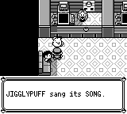
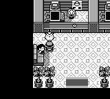

# 尼比市胖丁演出验证

尼比市宝可梦中心的胖丁现在保留开场文字，按原作歌曲结束状态旋转，恢复地图音乐后自动结束对话。移除旧实现多播的叫声和原作没有的两页叙述；旋转只覆盖显示图像，不永久改变 NPC 的逻辑朝向。

原作依据是 [PewterPokecenter.asm 的胖丁脚本](https://github.com/pret/pokered/blob/fbcf7d0e19a3a2db505440d3ccd3d40ca996c15c/scripts/PewterPokecenter.asm#L19-L84)：`PrintText` 后停音乐并等 32 帧，从当时图像朝向开始旋转，每完整 24 帧检查歌曲 CH1/CH2，结束后等 48 帧、恢复地图音乐并进入 `TextScriptEnd`。该脚本没有 `PlayCry`，也没有额外的演唱或困倦叙述。

## 正常 CLI 前后对照

使用相同的 32 KiB 物理存档、启动参数和从冷启动第 0 帧开始的 **2609 个完全相同输入**，两次都经过启动画面和普通 Continue。存档把玩家放在尼比市宝可梦中心 `(1,4)`，继续后朝下；等待 32 帧，再普通按上、A 与 `(1,3)` 的胖丁交谈。存档是离线构造的验证夹具，不代表从新游戏自然步行到达。

前：`2b1db12a5781425758386343662aea26b5196988`（PR #301 合入后的 master）。后：`f8f18b0ff2efdfcda56f40c8b16bb3ef01a943d1`。两者均为默认 dev profile、保留 debuginfo 并启用 `debug-server` 的正常 CLI；没有使用 release 或 debug=0 构建。

旧实现的首段文字在绝对第 608 帧等待确认。固定输入只在随后按一次 A，再观察 2000 帧，后实现也逐帧重放同一组输入，没有根据修复后的状态追加按键。**2000 帧是观察预算，不是写入产品的歌曲时长。**

下图都截于同一绝对第 **2609 帧**。前仍停在原作没有的 “JIGGLYPUFF sang its SONG.”；后已自动关闭窗口、回到同一玩家格子。另在第 608 帧各保留了一张原始审计截图，没有重复提交到仓库。

前：



后：



原始 pair receipt 的 SHA-256 为 `7aa4475d609038db5edaa11caa9da298562c01ac977dcd8ebed99c747ad79045`。它记录了 2 次正常冷启动、相同完整输入和截图帧、两份运行存档不变及进程清理。两个 Game 都在录制边界由所属录制器发送 SIGTERM 结束，退出码为 -15；这不是游戏自然退出。公开 `validation.json` 摘录来源、二进制、原始结果及图片散列。

## 音乐、输入和快照回归

在产品提交 `57792d9518678a82bbd2a711c26268f2692e0d48` 上实际执行 **26 个命名测试**：Core 演出 7、NativeHost 1、Data 协议 1、App 3、NPC 显示 13、Boa await 1，全部通过。整合 master 后的 `f8f18b0...` 保留这 17 个产品文件的相同字节；该整合提交另外完成上面的正常 CLI 构建及前后运行。没有把先前的 26 次测试重新标为在整合提交上执行。

App 测试直接运行未改动的歌曲序列、检查 PCM 输出及实际曲目结束，并将真实 GameSnapshot 装载到正在播放地图音乐的另一实例，验证不会误等循环背景音乐。共建立 3 个普通冷 SRAM 的 App 组件实例；CH2 单独活动的测试另为明确构造的音频组件控制，不能冒充原歌曲自然存在的 CH2 尾段。其余测试覆盖保留文字、四面交谈、24/48 帧边界、旧 A/新 A 按住释放、临时图像覆盖清理及两套脚本后端。

正常 CLI 的调试接口没有音乐曲目或 CH1/CH2 探针。因此截图和 native 状态只证明画面、流程与自动关闭；**音乐完成、PCM 和快照行为的证据来自 App 测试**，不能从截图或 `audio_sfx` 推断。原始定向测试 receipt 的 SHA-256 为 `b081b92123e6954dbf64aa575a5cb2e4e4240432fa74e3bbd0ce2b99cea41a43`，测试名称收录在 `validation.json`。

## 独立重放

`replay.py` 只依赖 Python 标准库和同目录公共资料，不导入任何私有临时文件。先检查资料及 RLE 展开：

```bash
python3 docs/validation/jigglypuff-song/replay.py --check
```

在上述前/后提交分别构建正常 `pokered-app`（`cargo build --locked -p pokered-app --features debug-server`，保留所需 gfx 资源），然后传入对应二进制和一个不存在的输出目录：

```bash
python3 docs/validation/jigglypuff-song/replay.py --binary /path/to/before/pokered-app --role before --output /path/to/new-before-run
python3 docs/validation/jigglypuff-song/replay.py --binary /path/to/after/pokered-app --role after --output /path/to/new-after-run
```

公开重放器经过语法和资料/RLE 检查，**没有额外运行 Game**。已完成的两次实际录制使用原始受审控制器，公开重放器是独立实现，不应被当作第三次验证。新机器重建的 ELF 散列可能不同，调用者应保证传入的二进制来自对应提交；重放器会记录散列和与原录制的匹配情况。

每次重放仅请求 `get_state`、`press_timeline` 和 `capture_frame`，固定 seed 42；不使用跳过开场、warp、状态设置器、脚本替换、快照启动或 seed 搜索。它复制夹具，逐帧重放，截取同一第 608/2609 帧并记录结果，最后只关闭自己创建的进程组。此对照只覆盖尼比市胖丁这一处正常交谈，不宣称其他剧情或整个游戏已经无差异。

## 合并新主分支后的验证

PR #304 合入 `074b91b47d713b88bffded1ab0ae0be2bb503a7a` 后，本分支普通合并该提交，保留 inner-pet 与 Jigglypuff 两套显式命令和各自参数校验/测试。合并产品源码 `bdf80626e5b548166811c8562e83ced4414ac623` 实际通过31个不同命名测试：Core21、Data/Boa7、App音频/渲染集成3。后者使用真实PCM sequencer、歌曲阶段与已发布的NPC图像，验证旋转像素、逻辑朝向保持、自然结束、音乐恢复和自动关窗。

原26项组件及两次正常CLI录制仍保留原始源码标签；这次31项是新主分支组合的组件回归，没有额外正常CLI录制。中途一次测试产物选择器把普通bin和integration-test两种可执行产物一起计数而停止；Cargo本身成功，选中真正test产物后直接执行3项App测试，未重复构建。发布的后续文档提交不改变已测产品源码，新的远端CI以最新提交为准。
