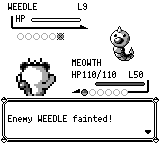
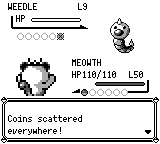
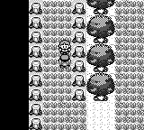
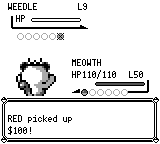

# 聚宝功：散钱、奖金与拾钱

原生实测基线为 `062e76d91fdbf5109fcc02793b8a8064788e8700`，候选为 `2ed00e00f949c3ab4f5181ebf7b2e86ab957b8cb`。证据保留实际构建身份；发布时新增的文档和截图不作为重新运行的程序。引擎固定为 `e533a3d23a0cdbed1524a1ac91184733da4a6f7e`。

原作 `engine/battle/move_effects/pay_day.asm` 在效果成功时累计钱池并显示 CoinsScatteredText；免疫造成零伤害会在调用效果前返回，替身吸收仍执行效果。`engine/battle/core.asm` 的 TrainerBattleVictory 只显示训练家奖金；`engine/battle/end_of_battle.asm` 在非连线、结果为 0 时另行领取聚宝功钱并显示提示，然后进入战后进化。玩偶和传送类离场保留此前结果；己方倒下写 1，有己方存活时的敌方倒下写回 0，成功 RUN/捕获写 2。

候选用真实伤害效果收据决定散钱，并按出招顺序补齐提示；战斗结果写入来自实际倒下事件。奖金、拾钱提示和最终金额分别处理。快照保存结果历史与已排入的拾钱提示；旧快照缺失历史时使用明确的兼容策略，不虚构已知逃离资格。

## 实际游戏验证

从附带的 32768 字节 SRAM 冷启动：喵喵 50 级、钱包 $1000，在常磐森林 (2,19) 用普通 UP/A 与训练家交谈，使用第一招聚宝功击倒其 9 级独角虫。继续游戏后朝下与原作一致，因此包含一次普通转身。两侧各重放同一段 2882 帧输入，seed 42，无运行中改状态。

| 事件 | 修复前绝对帧 | 修复后绝对帧 |
| --- | ---: | ---: |
| 散钱提示 | 缺失 | 2028 |
| 奖金页 | 2252：$190 | 2284：$90 |
| 拾钱提示 | 缺失 | 2308：$100 |
| 返回地图并写入钱包和训练家标记 | 2274 | 2340 |
| 2882 帧最终钱包 | $1190 | $1190 |

独立读取两侧各 2883 份状态、2882 次输入回执和全部 RPC；同帧输入、零填充、33 对 PNG 的尺寸和哈希、捕获前后状态、唯一训练家标记及进程退出均核对通过。应用由验证器完成后发送 TERM 清理，实际应用退出为 -15；验证器自身实际退出 0，两组应用均已回收。原生场景只覆盖这一次训练家战斗，其余分支由核心调用测试验证。

## 画面对照

以下散钱对比为同一屏幕、同一输入、同一绝对帧 2028。

奖金页面分别在 2252 / 2284 帧出现；新增的散钱提示使后续页面推迟。以下页面对照保留实际帧号，不将它们标为同帧。

拾钱对比为同一绝对帧 2308；修复前已经返回地图，修复后显示新增提示。

## 回归与复现

- 候选上 13 项聚宝功调用测试通过：两条回合入口、幽灵免疫、替身吸收和破裂、叫招、AI 重建、失败后不重复领取、奖金/拾钱顺序、玩偶和传送离场、倒下及换人历史、RUN/捕获/连线、上限和中途快照恢复。
- 同候选完整核心回归 3041 项通过，debug-server 应用构建通过。
- 首次替身测试曾把敌方合法再次制造替身的 HP 消耗误作本次命中伤害；仅修正下一回合动作以隔离测试，原始失败日志和身份保留在证据哈希中。

`before.sav`、`fixed-buttons.json` 和 `recorded-controller.py` 为原生复现输入。控制器要求真实的两侧构建、源码/引擎/702 个外部 GFX 文件和二进制身份计划；在各自检出中构建对应提交后，用实际本地路径和哈希建立计划。原始运行及独立读取收据的 SHA、各幅图片帧号和哈希见 `provenance.json`。
