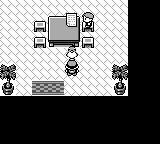
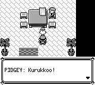

# 普通宠物：同一文本窗内播放叫声并等待确认

旧版必须先按键关闭全文窗口，才播放宠物叫声。修正版在全文显示完后直接播放叫声，保留同一窗口；声音完成后才接受静默的外层确认，再执行 A 松开等待并关闭窗口。本次迁移 **14 个普通 Far 文本宠物调用点**，共同使用一个 `FieldCry` continuation。胖丁、腕力施工 NPC、传说宝可梦和卡比兽等不同流程不在本次迁移范围。

原作依据是固定版本 `fbcf7d0e19a3a2db505440d3ccd3d40ca996c15c` 的 [VermilionPidgeyHouse.asm](https://github.com/pret/pokered/blob/fbcf7d0e19a3a2db505440d3ccd3d40ca996c15c/scripts/VermilionPidgeyHouse.asm) 和 [text_script.asm](https://github.com/pret/pokered/blob/fbcf7d0e19a3a2db505440d3ccd3d40ca996c15c/home/text_script.asm)：literal `@` 返回后播放并等待叫声，随后才由外层显示调用等待确认、A 松开和关闭。

## 实际验证

共 **104 次命名测试执行通过**，其中先前 95 次和本次追加 9 次分别保留真实源码标签；这个数字不代表新增或唯一测试数量。

| 实际测试源码 | 覆盖 | PASS 次数 |
|---|---|---:|
| `6f2efcb1cd7033af93a521ed749c150eae8ed82d` | Data 协议 1、Boa await 1、FieldCry/native 8、foreground 2、字速 2、Marowak 2、红莲问答 5、红莲战后调用 2、普通问答 5、自行车店 7、Agent 58 | 93 |
| `d14736cfdac42d80ead999ebce944495557ac954` | App default/debug 各一个物理冷存档组件实例：普通 CONTINUE 和 npc2 交互、实际叫声 sequencer/非零 PCM、窗口保留、静默确认及 A 松开 | 2 |
| `4c03d1e26c0ca752bec31cb0ee7c6dcd31ce1877` | Core FieldCry 8、Data 协议 1；其中一个新增参数化测试覆盖另外 13 个真实地图 NPC 的嵌入脚本 | 9 |

这 13 个组件子场景是 CeladonCity npc7、CeladonMansion1F npc1/3/4、CopycatsHouse1F npc3、LavenderCuboneHouse npc1、MrFujisHouse npc3/4、PewterNidoranHouse npc1、SSAnne1FRooms npc8、SSAnneB1FRooms npc8、SaffronCity npc12、SaffronPidgeyHouse npc2。它们使用实际嵌入场景和 ScriptVM、组件级位置/剧情前提及模拟音频完成输入；没有逐只进行物理 SAV、正常 CLI 或 PCM 验证。App 两例以枯叶市 npc2 波波为代表，使用实际音频管理器，未手工设置声忙状态。

普通合并 master 和这 13 个调用点后，最终产品头为 `a750fc9b353a49fcdede57d465c2faffde820cc5`；其整个 Git tree 与已执行 Core/Data 的 `4c03d1e…` 相同。历史 95 次执行保留各自源码标签，未重新标为最终头实测。

## 最终 master 与修复版的同帧对照

两次正常 CLI 均使用本目录同一份 32 KiB 预构造物理 SAV、启动前 seed 42、普通启动/CONTINUE 和真实 npc2 交互。**两边完整输入均为相同 682 帧，并在相同绝对第 678 帧截图。** 不用 snapshot、warp、skip、运行中状态设置、NPC 冻结或动态锚点搜索。

| 正常 CLI 记录 | 前 | 后 |
|---|---:|---:|
| 实际源码 | master `f6dd110e5f2a4f24d6a40d6794eda63ec3789bdf` | `a750fc9b353a49fcdede57d465c2faffde820cc5` |
| 普通启动/真实交互共同前缀 | 543 帧 | 543 帧 |
| 随后共同中性等待 | 69 帧 | 69 帧 |
| 全文首次完成帧 | 593 | 612 |
| 首次 B 输入前的共同状态帧 | 612：全文 Prompt，尚未叫声 | 612：全文完整、实际叫声 `SoundWait` |
| 首次 B2 结束帧 | 614：窗口已关闭、开始叫声 | 614：同一窗口、仍在 `SoundWait` |
| 实际叫声 33 活跃帧 | 614–629 | 612–627 |
| 共同后缀 | B2、N64、B2、N2 | B2、N64、B2、N2 |
| 截图绝对帧 | 678 | 678 |
| 完整输入长度 | 682 帧 | 682 帧 |

首次 B 的输入 offset 为 612（从 0 计），作用后的状态帧为 613。第 678 帧旧窗口已关闭，新版叫声已结束而同一完整窗口仍等待真正的外层确认。最后一组新 B2/N2 后，两边均在第 682 帧正常回到 field；物理存档字节未变，无 sidecar，玩家位置、金钱、背包、队伍和剧情标记保持。正常地图音乐鼓点可能使宽泛的 `sfx_playing` 为真，叫声完成依据实际叫声 ID 和 continuation 状态判断。

前：



后：



## 独立复放

按项目 [构建说明](../../../CLAUDE.md)，分别从上表两份实际源码构建正常 `pokered-app`，启用 `debug-server`：

```bash
cargo build --locked --bin pokered-app --features debug-server
python3 docs/validation/pidgey-cry-1079/replay.py --binary /path/to/before/pokered-app --role before --output /path/to/new-output/before
python3 docs/validation/pidgey-cry-1079/replay.py --binary /path/to/after/pokered-app --role after --output /path/to/new-output/after
```

`replay.py` 仅用 Python 标准库，读取本目录 SAV、单一紧凑 RLE 输入和验证元数据，不依赖本机会话目录。它严格复放同一 682 帧，检查第 612/614 帧叫声中的 B2、第 678 帧窗口状态、最终关闭及存档不变，输出 `comparison.png` 和 `result.json`。输出目录必须不存在；成功边界后由脚本终止自己启动的 Game，并如实记录退出码。

实际录制、源码、二进制和原始记录 SHA 见 `validation.json`。公开复放入口仅做了语法和输入无损展开检查，尚未另行启动 Game；不把它算成额外实测。最终两次 CLI wrapper 实际退出 0；Game 本身由诊断边界 SIGTERM 退出 -15。此前采用不同全文锚点的历史录制保持原始标签，其摘要另存于验证元数据，不用作这组最终截图。

本证据不代表当前版本全流程、GBA 设备音频或原作模拟器逐帧对照已完成。
