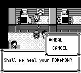

宝可梦中心护士专项验证。运行时修复源代码为 `03bdd6c7f6187e0d0e1a5a8b51728148cd2508e0`；主线驱动在 `b5731e382a6ce3408b59e314e2a00bab334c9edc` 改为选择真实的 `HEAL` 选项，并等待菜单开放输入。后一个提交仅修改 Python 驱动，游戏运行时代码保持一致。对照基线是当时的 master `d475146762149870bf73e99e9b648a37478ed9d0`。

原作依据为 [DisplayPokemonCenterDialogue_](https://github.com/pret/pokered/blob/fbcf7d0e19a3a2db505440d3ccd3d40ca996c15c/engine/events/pokecenter.asm)、[YesNoChoicePokeCenter](https://github.com/pret/pokered/blob/fbcf7d0e19a3a2db505440d3ccd3d40ca996c15c/home/yes_no.asm) 和 [Paragraph / PromptText](https://github.com/pret/pokered/blob/fbcf7d0e19a3a2db505440d3ccd3d40ca996c15c/home/text.asm)。本次恢复：欢迎词的 PARA/PROMPT、首次使用后的持久标志与询问句分支、HEAL/CANCEL 的上下限及 3/15 帧等待、治疗前记录重生地点、Need/DONE 不额外确认、FightingFit/PROMPT 后鞠躬，以及告别 DONE 后外层的静默确认、松开 A 和关闭等待。12 个中心和共享护士模块接入该流程；西尔佛公司 9 层的休息事件保持原来的独立逻辑。

`fixture.sav` 是离线构造的专项存档：常青市中心柜台下方 `(3,3)`，队首超梦为 1 HP、0 PP，原作 used-center 位未设置。`fixture-input.json` 保留构造状态。专项存档验证不能代表从新游戏通关。

前后主图从完全相同的存档开始，逐帧播放同一份 `pair-inputs.json`，在第 1069 帧捕获。同一输入下，前仍停在合并的欢迎文字，后已进入 HEAL/CANCEL，按上仍停在 HEAL。这两张图记录本 PR 导致的流程变化，并非原版 GB 字体或对话框布局对比。另一次正常输入控制分别到达双方菜单，确认旧版 UP 会循环到 No，修复版 UP 不循环；这些不同输入长度的诊断控制没有冒充同帧主图。




`save-inputs.json` 先正常交谈并取消治疗，再打开 START → SAVE → 确认保存，返回 START 后按 B 回到地图。实际写出的 `normal-saved.sav` 的 SHA-256 为 `76a266adf04f032cb73124eacd356a9f148feee12e54208f5d0ea65392b04594`。导出读取确认压缩的 `status_flags[4]` 从 0 变为 6（原作同时设置 bit1 和 used-center bit2）；取消时 HP/PP 和重生地点均未变化。随后只复制该 SAV，另起独立进程，经 CONTINUE 正常交谈，确认询问句被跳过；没有复制侧文件，也没有用调试保存或运行时状态写入。

`replay.py` 只依赖 Python 标准库，调用正常的 `pokered-app run`，允许的调试命令仅为读取状态、播放逐帧按钮和截图。目录内五种专项录制均已用独立进程回放通过；保存结果逐字节相同。游戏进程在诊断终点由工具终止，不能将该退出当作自然通关。

```bash
# 分别在基线和修复检出构建正常 CLI，包含 desktop,debug-server。
# 如需严格校验所用二进制，可附加 --expected-binary-sha256 HASH。
python3 replay.py --binary /absolute/base/pokered-app --scenario pair-before --output /new/path/before
python3 replay.py --binary /absolute/fixed/pokered-app --scenario pair-after --output /new/path/after
python3 replay.py --binary /absolute/fixed/pokered-app --scenario save --output /new/path/save
python3 replay.py --binary /absolute/fixed/pokered-app --scenario continue --saved-sram /new/path/save/pokered.sav --output /new/path/continue
python3 replay.py --binary /absolute/fixed/pokered-app --scenario heal --output /new/path/heal
# 也可用随包实际生成的 normal-saved.sav 加速独立读档验证。
```

`heal-inputs.json` 从相同的 1 HP/0 PP 存档选择 HEAL，在 Need/DONE 到实际恢复之间不再按 A；第 1172 帧的真实机器阶段已恢复 HP/PP。第 1545 帧检查 FightingFit 的最后一页 PROMPT 等待输入，随后完成鞠躬、告别及正常 SAVE。`healed-saved.sav` 由该流程真实写出，保存的重生地点为常青市（1），队首 342 HP、PP 全部恢复。回放会在 1080、1172、1545 帧逐一检查这些边界。

本地验证包括完整 pokered-core 测试（3,126 个单元测试及该 crate 的集成/文档测试）、pokered-data/Boa（308 个单元测试及集成/文档测试）、61 个语义索引测试、应用层四组冷 SRAM/普通按键治疗与取消组合，以及 98 个主线驱动测试。状态机回归检查欢迎词等待、条件 text_pause、菜单优先级、恢复地点写入时机、外层确认和快照恢复。实际运行证据与输入、存档、源码哈希见 `evidence.json`。

本包只包含护士专项证据，不代表主线全链或整体差异审计完成；该轮全新主线执行结果另列于 PR 说明。
