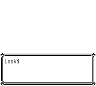
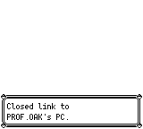
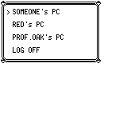

# 图鉴评价：声音与确认顺序

原作 DisplayDexRating 会等待已有音效结束，停止音乐，按持有种类播放七档评价音效，等待实际结束，再重新播放地图默认音乐并接受无声确认。电脑调用方随后显示关闭连接文字并另行确认；研究所调用方等待 A 松开再关闭窗口。名人堂只取评价文字，保持纯选择器。

本修复保留已有电脑四行布局。七档范围为 0–9、10–39、40–59、60–89、90–119、120–149、150–151。对应 Denied、PokedexRating、GetItem1、CaughtMon、LevelUp、GetKeyItem、GetItem2。

## 普通 CLI 配对

前：`75caea6488c03933cb32f33c2d737a7504ff82c0`（当时 master）。后：`75686526660ac0e1cdfc63fe9f9303dc405412e0`（实际测试产品提交）。

两次均从同一份 32KB 实体 SAV 正常冷启动、Continue，以同一份 1,645 帧普通输入操作枯叶之前可用的常磐市宝可梦中心电脑。起点 `(13,4)` 朝上，持有/见过各 40 种。不使用运行时状态写入、地图传送、剧情替换或快进。存档由原有物理存档经纯 SaveData 编解码工具调整地图、方向和图鉴位图，校验与逐字节重新导出一致；不是正常游玩到该收集数量的证明。

修复前没有 GetItem1 播放区间；修复后实际 sequencer 在 846–918 帧播放 GetItem1。两版在 1,645 帧都回到电脑主菜单，物理 SAV 不变，事件标志不变。声音阶段截图相同，声音证据来自逐帧状态与另行 PCM 验证。

首次修复前录制在 701 帧因控制脚本连续按 A、没有松键而停在确认菜单；失败保留，子进程退出并确认进程组消失。修正控制脚本后才得到本配对。没有将该失败归为游戏差异。

| 同帧场景 | 前 | 后 |
|---|---|---|
| 727：评价开始 |  |  |
| 895：评价音效期间 |  |  |
| 1515：等待确认 |  |  |
| 1516：关闭连接文字入口 |  |  |
| 1636：持续按住 A |  |  |
| 1645：返回主菜单 |  |  |

## 复放

安装仓库构建依赖并准备 gfx，检出对应产品提交，然后从仓库根目录构建：

```bash
cargo build -p pokered-app --features desktop,debug-server --bin pokered-app
python3 docs/validation/pokedex-rating/replay.py --binary target/debug/pokered-app --role after --output /tmp/pokedex-rating-replay
```

修复前提交没有本目录；先保留此复现包，再对其构建的 binary 使用 `--role before`。`--output` 必须尚不存在。脚本只发送 get_state、press_timeline、capture_frame，核对固定检查帧与 SAV 不变；不会修改游戏状态。输出记录进程关闭，不将人为停止当作游戏自然退出。

公开复放脚本已做语法与输入检查，未为它额外启动第三个 CLI。记录时的控制器逐帧观察了完整音效区间；公开复放核对区间首、中、尾及截图检查帧，不宣称它逐帧扫描声音。

## 分层回归及限制

`validation.json` 逐项记录实际源提交与原始日志 SHA。较早的 `3cd01cca` 提交通过 64 项 PC 回归和一个覆盖全部 0–151 持有数量的实际嵌入大木博士脚本测试。当前产品提交通过 4 项音效选择/等待/序列化及 Native 协议测试、2 项 Data/Boa 协议测试、3 项实际 SAV 冷启动 App 流程测试，以及 3 项胖丁集成回归。

三个 App 流程测试分别覆盖七档评价音效（七次实体 SAV 会话）、电脑拒绝评价、研究所评价，共九次会话。音频使用真实 `AudioOutput::new_pcm`、实际 sequencer 完成状态和非零 PCM；电脑流程每帧比较增量渲染与完整重绘。研究所核对无声确认、按住 A 保持窗口、松 A 后关闭。这些是 App 测试进程中的真实普通输入会话，与上述独立 CLI 配对分别记录；本次 CLI 截图只覆盖持有 40 种的电脑入口。

研究所脚本全部 81 段英文原文逐项保持一致。本记录不证明其他剧情/功能已全部追平，也不包含实际扬声器设备或逐波形 ROM 音频对照。
