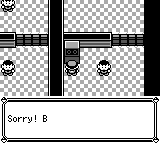

# Script choice confirmation sound

Accepting a common scripted choice with A or B now emits the existing `TextAdvance` event once. The shared App consumes it as `SfxId::PressAB`. Idle, cursor motion and held input do not add repeated confirmation sounds. Existing post-capture nickname sound ownership is unchanged.

The original `HandleMenuInput` plays `SFX_PRESS_AB` for normal A/B selection. This focused change restores that sound. The original 15-frame selection-end wait, A+B priority and richer typed menu contracts remain separate work.

## Executed validation

Actual base: `762fc5a32602d7dcee4da23a687ad42a7751384d` (M1). Actual tested source: `77db4bcb3dc745a4b913c61301ff28852dd64e2e`. The publication child adds only documentation and evidence; production and tests are byte-identical to that tested source.

- Four core tests passed: embedded Bill scene, idle/cursor, A/B/A+B, held-button, nested gift and reading choices. Existing A-first A+B result is deliberately retained.
- Four App tests passed, covering seven cold physical-SRAM cases. The new A/B cases isolate the confirmation observation, assert real `PressAB` PCM, one sound start while held, and the later existing GET_ITEM/DENIED sound sequence. The prior sound is asserted naturally idle at the choice; no audio padding or fake busy flag is used.
- The debug CLI built successfully. No full core/App suite or GBA execution is claimed by these local checks.

Commands actually used, each once, serially in the same isolated target:

```sh
cargo test -vv --offline --locked -j1 -p pokered-core --lib choice_confirm_audio_tests -- --test-threads=1
cargo test -vv --offline --locked -j1 -p pokered-app --bin pokered-app --features debug-server cinnabar_quiz_audio_tests -- --test-threads=1
cargo build -vv --offline --locked -j1 -p pokered-app --bin pokered-app --features debug-server
```

The [evidence summary](script-choice-confirm-audio-1060/evidence.json) records exact command output hashes and named tests. Compact actual [core](script-choice-confirm-audio-1060/core-test-excerpt.txt) and [App](script-choice-confirm-audio-1060/app-test-excerpt.txt) stdout excerpts are included; complete stdout hashes are in the summary.

## Matched ordinary-input replay

The actual M1 and 77db binaries each cold-booted normally with the same [32 KiB physical SRAM fixture](script-choice-confirm-audio-1060/locked-preboot.sav), seed 42, English, headless speed 0, muted audio output, and the same [2012 literal buttons](script-choice-confirm-audio-1060/buttons.json). This is save-assisted verification, not an unassisted playthrough. No snapshot, runtime setter, script/map override, skip-intro, extra neutral padding or input adjustment was used. Muted output still advances the actual audio owner.

The vector is `70 × (A1 + neutral7) + neutral32 + Up2 + neutral4 + A2 + neutral4 + 44 × (B1 + neutral31)`. The [executed controller](script-choice-confirm-audio-1060/executed-controller.py) and [executed plan](script-choice-confirm-audio-1060/executed-plan.json) are archived byte-for-byte. Their absolute source-freeze/binary/audit paths describe the local execution; they are not advertised as a portable one-command runner. To repeat the scenario, build each source, copy the fixture to a separate writable save path and run `pokered-app run --headless --speed 0 --seed 42 --debug-port PORT --lang en --no-audio --save COPY.sav`; submit the literal vector through one-frame `press_timeline` inputs and capture the same absolute frames. The archived controller specifies the exact read-only observations and assertions.

Public state, NPCs and flags matched at every frame 0–1020. At 1021 both were in `WaitSound`: before had idle audio, after had `PressAB` (native ID 63). The new sound was active at 1021–1037; the following DENIED began at 1039 instead of 1023. NPC walking, completion, exact prebattle text and ordinary B acknowledgment then led to battle at 1214 instead of 1182. These events were observed; they never drove the fixed inputs.

Both runs completed all 2012 inputs. HP, PP, money, coins, badges, party and bag checks passed; gate/trainer flags stayed unset. Each screenshot was 160×144 and followed by read-only state/NPC/flag equality checks. All 45 raw artifact hashes and 32 original captures were checked; owned Game and runner process groups were confirmed gone. The final frame 2012 PNGs were byte-identical. Full raw logs and source freezes remain in the local audit; the summary preserves their hashes.

At frame 1064, before is already drawing “Sorry! B” while after still retains the quiz question. This visible timing difference follows the existing `WaitSound` behavior after adding the missing sound. It does not implement the separate original 15-frame completion delay.




Validation note: the first native attempt stopped on an incorrect plan expectation `PressAB=144`; it is preserved. A separately approved plan corrected the source-proven native ID to 63, without changing the inputs, anchors or other assertions, and the new attempt completed. Native PCM waveforms, direct RNG equality, hardware frame parity and complete gameplay parity are not claimed.
