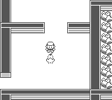
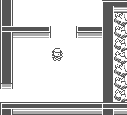

# 固定宝可梦遭遇流程回归

修复对象：超梦、闪电鸟、急冻鸟、火焰鸟。原作参考为
`pret/pokered fbcf7d0e19a3a2db505440d3ccd3d40ca996c15c`。

原作四地图的 `BattleText` 经 `TalkToTrainer` 先完成内层文字，再播放叫声并等声音结束；随后准备敌方物种/等级、播放 `MUSIC_MEET_MALE_TRAINER`，最后才等外层文字确认、A 松键、关窗。进入野战后还有一次正常的战斗开场叫声。不能把这第二次叫声删除。

对应原作文件：`scripts/{CeruleanCaveB1F,PowerPlant,SeafoamIslandsB4F,VictoryRoad2F}.asm`、`home/trainers.asm` 的 `TalkToTrainer / EngageMapTrainer / StartTrainerBattle / EndTrainerBattle`、`home/text_script.asm`、`engine/battle/common_text.asm`。

捕获完成后，原作先返回图鉴、命名和入队/入箱流程，再执行 `EndTrainerBattle`。此前实现过早交付脚本结果，且地图淡入的第一帧还可能出现已捕获对象。现在在捕获 UI 完成后交付结果，并在地图淡入前应用紧接的隐藏操作。打倒、捕获、成功 RUN、玩偶脱离都会消耗固定遭遇；战败保留。

## 独立重放

先在待测提交构建普通 CLI：

```bash
cargo build -p pokered-app --bin pokered-app --features desktop,debug-server
python3 docs/validation/static-encounter-1091/replay.py \
  --binary target/debug/pokered-app --case capture --output /path/to/new-output
```

输出目录必须不存在。可选 `--port 19089`。`manifest.json` 列出全部 11 个 case、存档/输入文件 SHA-256、帧数和最终断言。脚本仅启动普通 CLI，使用 `get_state/get_flags/get_npcs/get_bag` 观察、`press_timeline` 输入和 `capture_frame` 截图，不注入战斗结果或运行中改状态。

| case | 覆盖 |
|---|---|
| intro | 闪电鸟场上交谈、叫声、确认和实际进入战斗 |
| capture | 实际 Master Ball 捕获，新图鉴、命名 NO、回地图及对象隐藏 |
| win / run / doll | 实际 Psychic 打赢、菜单 RUN、Poké Doll 脱离 |
| blackout | 实际战败黑屏，遭遇事件不消耗 |
| save | 实际打赢后从开始菜单 SAVE，检查 SRAM 长度与校验和 |
| continue | 新进程只加载 save 产生的 `.sav`，检查消耗状态、隐藏和队伍/PP |
| mewtwo / articuno / moltres | 各自地图冷启动、交谈、叫声/确认与实际战斗入口 |

这些存档是启动前构造的专项测试状态，并非从新游戏走到传奇地点的证据。
`fast.sav` 的 Mewtwo100 由 Core 构造函数计算合法属性、招式和 PP，用于确定性的打赢/RUN 控制。
普通 SAVE 会生成脚本标志旁文件；`continue` 故意只携带实体 `.sav`，证明该遭遇的关键事件与对象移除不依赖旁文件。

`capture` 的第 2653 帧是同一输入下返回地图淡入的第一帧。前图来自 master `e33d4af3199b9ef3e9b5823a2001ed0a6ca55509`，后图来自合并该 master 的修复提交 `50a96d1f9841aed3e6ba2661b29e35dc41f8e349`。

前：



后：



## 验证边界

本包的最终状态重放不代替中间调用时序验证。Core 测试覆盖四图前导和准备阶段快照恢复；App 测试通过真实 sequencer/PCM 验证场上叫声、遭遇音乐及战斗入口。捕获组件测试明确注入 settlement，仅验证捕获 UI 的 continuation 边界；本包 `capture` 则真实投球。

普通 CLI 使用 `--no-audio`，观测逻辑 SFX 状态，不声称采集了原机与复刻的逐采样音频比较。捕获 modal 的运行时 `save_state` 仍按现有契约拒绝，不把它宣称为已支持的快照功能。战败控制验证黑屏与事件保留，没有宣称包含从恢复点重新走回全部四图。

集成提交 `50a96d1f` 本地结果：Core 3114；Data（含 Boa）305；App 固定遭遇 2、捕获相关 13（另有 1 个既有忽略项）；Agent 1，全部通过。11 条普通 CLI 重放均通过。详见 `receipts.json`。
