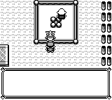
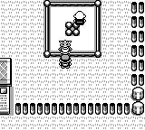
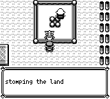
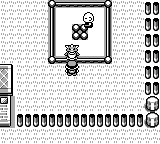

# 枯叶市怪力：叫声后续接同一段文字

原作 `fbcf7d0e19a3a2db505440d3ccd3d40ca996c15c` 的 [VermilionCity.asm](https://github.com/pret/pokered/blob/fbcf7d0e19a3a2db505440d3ccd3d40ca996c15c/scripts/VermilionCity.asm#L224) 先用 Far PrintText 打印怪力台词，直接播放并等待叫声，再回到包含 PARA、CONT、DONE 的后续文字。原作 [home/text.asm](https://github.com/pret/pokered/blob/fbcf7d0e19a3a2db505440d3ccd3d40ca996c15c/home/text.asm#L230) 在换段后清窗等待20帧，CONT 分两次各5帧滚动，最后才进入外层确认、A松开和关窗。

旧实现把台词与描述拆成两个独立普通对话，叫声前先确认并关窗；没有这次连续换段和滚行。新显式 `fieldCryContinuation(initial,species,paragraph,tail)` 保留同一窗口的所有权，在实际叫声完成后进入换段提示，再滚动并追加最后的 `flat.`。逻辑内容及双语文本保持原意，字体及既有行距保持；滚动使用当前12px行距的半行6px。

## 实际验证

25个不同定向测试名均有PASS：3个执行于 `9518a530cddf3802a53f266c10bf0e857ae9f9a3`，另22个执行于 `a43140df0a31f1a6817a0d791d05559a49d73ce1`。保留了最初一次内嵌DSL测试缩进错误；只修正该测试字符串缩进，所有产品代码及断言未变。验证包含真实嵌入NPC5脚本→VM→完整continuation、声音中输入、PARA/CONT/DONE、快照恢复至独立Core、Native/Data/Boa合同和已有Far调用回归。组件声音忙碌样本属于组件测试，不宣称PCM或真实设备验证。

之后普通合并 master `611ecf6448c12668510586a2ee41817bea06dd48`，产品提交为 `130ee87b4d380b6c4f7f37122a817e0cded01094`；相对新master的补丁与合并前相同。

正常桌面CLI前后各一次冷启动，从同一32 KiB物理SAV普通CONTINUE。存档位置为枯叶市 `(29,10)`、朝下，处于合法可通行格、无NPC/warp/sign重叠；怪力NPC5保持原始Wander/range1。before只读观察其位置，用普通方向键和A接近交谈；after完整复放同一1313帧输入，无NPC冻结、warp、snapshot、运行中setter或选种子重试。seed42只在每次CLI启动前配置。

| 绝对帧 / 事件 | 前：M16 | 后：130ee87 |
|---|---|---|
| 615 | 普通CONTINUE到枯叶市 | 同左 |
| 655 | 开始NPC5台词 | 同一交互开始 |
| 实际MACHOP叫声50 | 978–1016 | 739–777，全文窗口始终保留 |
| 976，第一次B前 | 仍等待确认首段，尚未叫 | 已叫完，等待PARA |
| 977，B后 | 普通首段关闭 | ParagraphClear20，确认声 |
| 979 | 空的第二窗口、旧叫声活跃 | 换段清窗中，新叫声早已结束 |
| 1147 | 描述已关闭、普通地图 | CONT第一次半行滚动，ScrollFirst5 |
| 1152 | 普通地图 | 第二次滚动，原底行进入顶行，ScrollSecond5 |
| 1275 | 普通地图 | 完整最后台词等待OuterAck，无新增提示箭头 |
| 1280–1311 | 朝向空格的普通A保持 | A保持窗口，未产生PressAB |
| 1312 / 1313 | 普通地图 | CloseWait / 返回普通地图 |

979帧两张PNG完全相同，不能把它当作修正版叫声期间窗口的画面证明；修正版实际739–777帧的完整窗口/叫声证据来自逐帧状态。其余三组同帧图展示滚行与外层窗口。旧实现较早回到地图，NPC可继续游走；后者仍在阻塞对话中，这是相同输入下的自然状态差异。最后向下2帧使已关窗的before朝向空格，避免随后A重新对话；after仍在窗口内而忽略该方向，最终朝向分别Down/Up，位置均未移动。

| 帧 | 前 | 后 |
|---|---|---|
| 979 |  |  |
| 1147 |  |  |
| 1152 |  |  |
| 1275 |  |  |

两次wrapper退出0；Game在验证边界后由各自recorder诊断性SIGTERM退出-15，进程组均消失。金钱、队伍、背包、剧情标记、物理SAV字节均保持，无sidecar。证据来自当前App的真实逻辑sequencer与状态机；没有PCM、扬声器或原作模拟器逐帧对照，也没有在本候选重新跑完整主线。

## 独立复放

分别检出上表的before M16与after 130ee87源码，构建正常桌面程序，再从包含本目录证据的检出运行脚本：

```bash
cargo build --locked -p pokered-app --features desktop,debug-server --bin pokered-app
python3 docs/validation/vermilion-machop-1084/replay.py --binary /path/to/before/pokered-app --role before --output /path/to/new-output/before
python3 docs/validation/vermilion-machop-1084/replay.py --binary /path/to/after/pokered-app --role after --output /path/to/new-output/after
```

脚本仅依赖Python标准库、本目录存档/输入/清单，按固定输入逐帧复放，检查真实叫声区间、关键状态、四组同帧截图与最终存档保持；输出记录实际所给binary的SHA，调用者需选择正确源码。公开脚本只做语法和RLE展开核对，未额外启动Game；原始正常验证使用另一个已固定SHA的录制器，其标识与实际来源记录在 `validation.json`。图片字节匹配结果仅记录，不替代流程/状态断言。

## 发布前整合最新主分支

普通合并 PR #304 后的 master `074b91b47d713b88bffded1ab0ae0be2bb503a7a`，产品提交为 `66ad1d7b9c2bae69c88e333c8c9241b31df17a20`。相邻接口冲突保留两套显式命令及各自校验和测试；怪力状态机、其测试、VermilionCity脚本及App滚行renderer四个文件与正常录制源码逐字节相同。该组合源码另完成26个命名Core/Data/Boa测试以及正常桌面App的renderer类型检查，均通过。它与前述25项属于不同验证组，不能相加当作51个不同测试。新主分支上的原有宠物调用也在这组中。

正常CLI前后仍标注M16 / 130ee87，本次组合验证没有增加Game；后续文档提交不改变产品源码。


### 合入胖丁修复后的集成回归

在主分支 `75caea6488c03933cb32f33c2d737a7504ff82c0` 上正常合并，
产品提交 `97c203f1722b3be3626b5024ed52149790da0a70` 通过 36 项具名测试
（怪力、通用叫声、胖丁及 Native/Boa 协议），并通过桌面 App 编译检查。
本轮未新增游戏进程；上文实机前后对照仍对应其明确记录的源提交。
